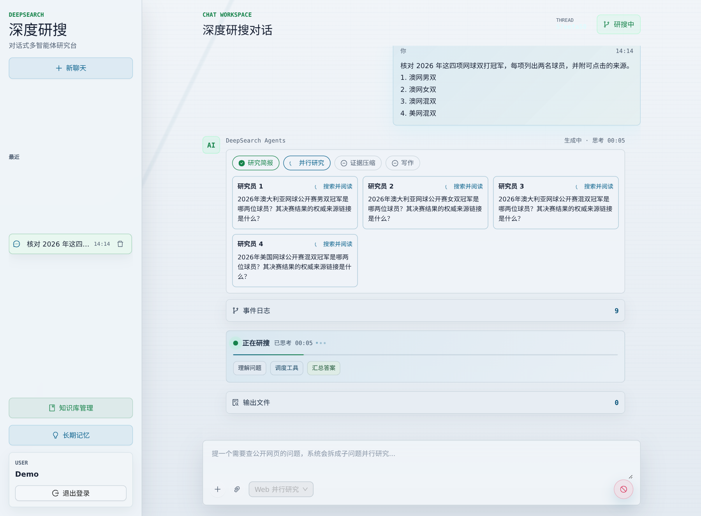
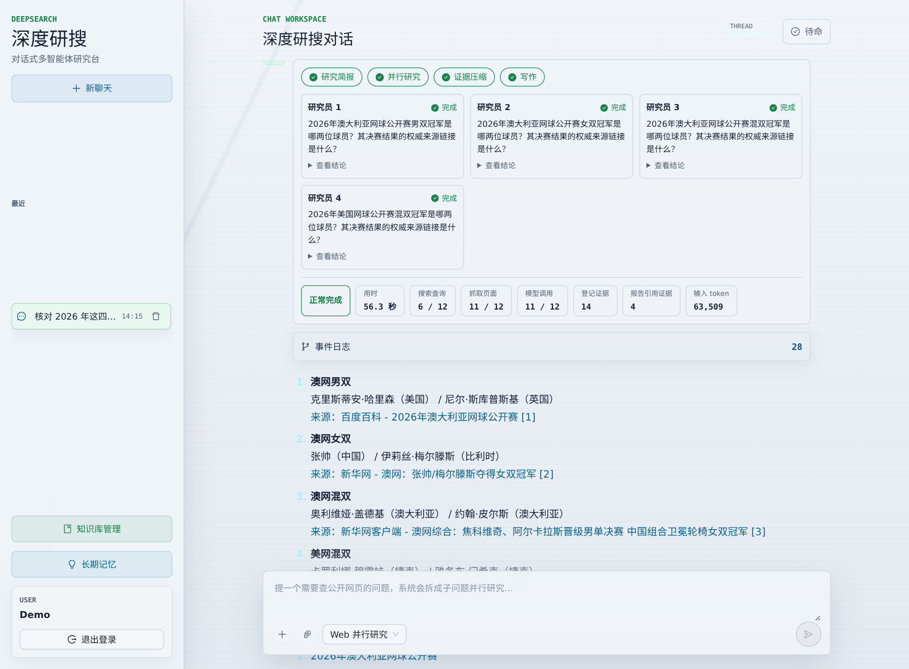
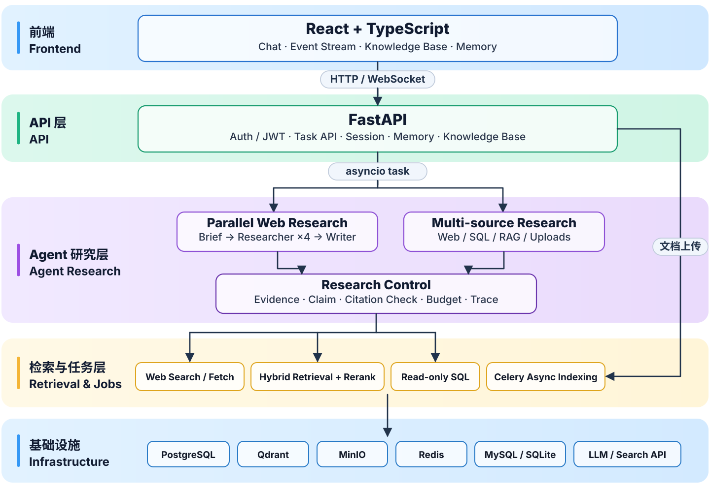
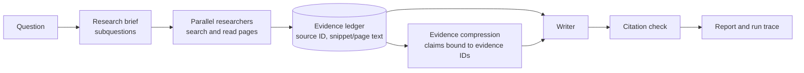

# DeepSearch Agents

<p align="center">
  <a href="README.md">中文</a> | English
</p>

DeepSearch Agents is a multi-agent research assistant that produces cited reports with a full run trace. It splits a question into subquestions, dispatches several researchers in parallel to search and read the web, and writes a report with links back to cited sources. Besides the public web, it can use a local knowledge base, a SQL database and uploaded files.



## Web research in action

This tennis doubles lookup dispatched multiple researchers to investigate different subquestions in parallel. The completed view shows stage status, search and model usage, and source links in the report.



## System architecture



The frontend submits tasks over HTTP; FastAPI runs research in background asyncio tasks and streams progress and the final report over WebSocket. Web-only questions take the parallel research flow below; questions that involve the knowledge base, a database or uploads take the multi-source flow. Knowledge-base documents are parsed and indexed asynchronously by Celery workers, with Redis as the task queue.

## Research flow



- **Research brief**: one structured call that returns constraints and subquestions.
- **Parallel research**: backend code dispatches one researcher per subquestion. Each researcher has a single search tool and at most two model calls.
- **Evidence ledger**: every fetched page becomes an evidence record with a stable ID, stored by the backend and never paraphrased by a model.
- **Compression and writing**: each claim must cite evidence IDs, which the backend validates. The writer reads both the claims and the source text.
- **Budget and trace**: every run is capped on searches, pages, model calls and time, and each phase records its calls and where the evidence went.

## Features

- Multi-source research: public web (Tavily, DuckDuckGo, Perplexity, SearXNG), local knowledge base (hybrid BM25 and vector retrieval), read-only MySQL queries, uploaded files.
- Traceable reports: evidence IDs after each statement link back to the page or document passage.
- Web workspace: chat, live task events, knowledge base management, conversation history, downloads.
- Sessions and memory: sign-up and login, conversation summaries, user-managed long-term memory.
- Evaluation tooling: end-to-end, process and retrieval-component evaluations with reproducible summaries.

## Evaluation

**Run process.** The earlier version let a supervisor model decide when to delegate; it often called unrelated tools and ran out of budget. After switching to code-driven parallel dispatch with restricted researcher tools, on 15 DeepResearch Bench tasks:

| Metric | Supervisor loop | Parallel research |
| --- | ---: | ---: |
| Completed without degradation | 2/15 | 12/15 |
| Median time per task | 118.5 s | 58.1 s |
| Median input tokens per task | 72,932 | 36,192 |
| Tool calls unrelated to research | 53 | 0 |

See [process evaluation](docs/development/drb-process-evaluation.md) (in Chinese).

**Recent-fact questions.** The questions ask about events from 2026 that the model cannot answer from memory. Each has four fact items, judged one by one against official sources. The original 12 questions were used for debugging; the 6 held-out questions were run separately after fixes.

| Question set | Closed book | Single round (≤3 queries) | Single round (≤8 queries) | Parallel research |
| --- | ---: | ---: | ---: | ---: |
| Original 12 questions | 0/48 | 30/48 | 39/48 | 42/48 |
| Held-out 6 questions | 0/24 | 17/24 | 19/24 | 23/24 |
| Median time per question (original) | 1.2 s | 13.3 s | 13.9 s | 38.2 s |

Parallel research answered 3–4 more items than the ≤8-query baseline on both sets; on the original set it took about 2.8× the median time and 4.6× the median input tokens. See [recent-fact evaluation](docs/development/retrieval-necessity-2026.md) (in Chinese).

**Local knowledge base retrieval.** On a fixed RFC 9110 / 9111 corpus, switching lexical ranking to BM25 raised labelled evidence hits on 7 development questions from 6/15 to 15/15. See [BM25 comparison](evals/rfc_demo/bm25.md) (in Chinese).

All experiments use Qwen Flash on small question sets, with one run per configuration; live search results change over time. The citation check verifies that evidence IDs exist; whether the source supports a claim is measured separately by the recent-fact evaluation. Report-content scores for the earlier version are in [DRB evaluation and crossover](docs/development/drb-duckduckgo-15.md) (in Chinese).

## Quick start

Requirements: Docker and Docker Compose, Node.js and pnpm, and an OpenAI-compatible model API.

**1. Clone and configure**

```bash
git clone https://github.com/huichimegumi/deepsearch-agents.git
cd deepsearch-agents
cp .env.example .env
```

Edit `.env` and set at least the model configuration:

```dotenv
LLM_PROVIDER=dashscope
OPENAI_BASE_URL=https://dashscope.aliyuncs.com/compatible-mode/v1
LLM_NAME=qwen-flash
DASHSCOPE_API_KEY=

# Enable parallel web research
RESEARCH_WORKFLOW=parallel_web

# Search: unconfigured backends are skipped; DuckDuckGo needs no key
SEARCH_BACKEND=auto
TAVILY_API_KEY=
```

`LLM_PROVIDER` accepts `dashscope`, `deepseek` or `openai`, which read `DASHSCOPE_API_KEY`, `DEEPSEEK_API_KEY` or `OPENAI_API_KEY`. See [`.env.example`](.env.example) for the remaining settings.

**2. Start the backend**

```bash
docker compose --env-file .env -f docker/docker-compose.yaml up -d --build
curl http://localhost:8000/health/ready
```

This starts the API, the indexing worker, PostgreSQL, Redis, Qdrant, MinIO and MySQL.

**3. Start the frontend**

```bash
cd frontend
pnpm install
pnpm dev
```

Open `http://localhost:5173` and register an account. The default registration switch, JWT secret and service credentials are for local development; replace them before any public deployment.

**Start a parallel web research run through the API** (parallel mode currently requires `"sources": ["web"]` in the request):

```bash
curl -s http://localhost:8000/api/task \
  -H "Authorization: Bearer $TOKEN" -H 'Content-Type: application/json' \
  -d '{"query": "Who won the 2026 Australian Open doubles titles?", "sources": ["web"]}'
```

`$TOKEN` is the `access_token` returned by `POST /api/auth/login`. Use the returned `thread_id` with `WebSocket /ws/{thread_id}?token=<token>` to receive live events and the final report. Login, local development, test commands and the full API list are in the [manual](docs/manual.md); to reproduce the evaluations, see [`evals/README.md`](evals/README.md).

## Project structure

```text
app/
├── agent/      # Research flow: brief, parallel researchers, compression, writer, budget and trace
├── research/   # Evidence and claim schemas, citation validation
├── search/     # Search backends, fallback and page text extraction
├── rag/        # Document parsing, indexing, hybrid retrieval
├── api/        # FastAPI, WebSocket, conversation and knowledge base endpoints
├── memory/     # Conversation summaries and long-term memory
└── tools/      # Search, database, knowledge base and file tools
evals/          # Evaluation scripts and publishable summaries
docs/           # Evaluation reports, design notes, manual
frontend/       # React workspace
docker/         # Dockerfile and Compose
```

Stack: LangChain / LangGraph / DeepAgents, FastAPI, Celery, PostgreSQL, Qdrant, Redis, MinIO, React, TypeScript.

## More documentation

- [Manual and development log](docs/manual.md): full setup guide, API list and history
- [Parallel research design](docs/development/parallel-research-design.md) (in Chinese)
- [Earlier fixed-corpus evaluation](EVAL.md)
