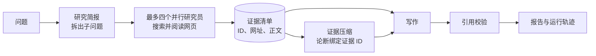
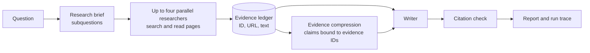

# DeepSearch Agents

<p align="center">
  <a href="#中文">中文</a> | <a href="#english">English</a>
</p>


## 中文

DeepSearch Agents 是一个带来源引用和运行轨迹的多智能体研究助手。提出一个问题后，系统把它拆成子问题，并行派出多个研究员搜索和阅读网页，最后生成带原文链接的研究报告。除公开网页外，它还支持本地知识库、SQL 数据库和上传附件。

### 实际运行

这次网球双打查证同时派发了四位研究员。任务完成后，界面展示各阶段状态、搜索和模型用量，以及报告中的原文链接。


### 工作流程



- **研究简报**：一次结构化调用，输出约束和子问题。
- **并行研究**：由后端代码按子问题派发研究员，每个研究员只有搜索工具，最多两次模型调用。
- **证据清单**：每个网页登记为一条带固定 ID 的证据，保存在后端，不经过模型转述。
- **证据压缩与写作**：论断必须引用证据 ID，后端校验 ID 存在；写作模型同时读取论断和证据原文。
- **预算与轨迹**：每次运行受搜索次数、页面数、模型调用数和时间四个上限约束，各阶段的调用和证据去向写入轨迹文件。

### 功能

- 多源研究：公开网页（Tavily、DuckDuckGo、Perplexity、SearXNG）、本地知识库（BM25 与向量混合检索）、MySQL 只读查询、上传附件。
- 可追溯报告：句后引用证据 ID，可点回原始网页或文档片段。
- Web 工作台：聊天、实时任务事件、知识库管理、历史会话、结果下载。
- 会话与记忆：用户注册登录、会话摘要、可管理的长期记忆。
- 评测工具：端到端、过程和检索组件三层评测脚本，结果可复算。

### 评测结果

**近期事实题。** 题目问 2026 年发生的事实，模型自身答不出。每题 4 个事实项，对照官方出处逐项判分，全部字段正确才得分。

| 题集 | 闭卷 | 单轮检索（≤3 查询） | 单轮检索（≤8 查询） | 并行研究 |
| --- | ---: | ---: | ---: | ---: |
| 原 12 题 | 0/48 | 30/48 | 39/48 | 42/48 |
| 独立 6 题 | 0/24 | 17/24 | 19/24 | 23/24 |
| 每题耗时中位数（原题） | 1.2 秒 | 13.3 秒 | 13.9 秒 | 38.2 秒 |

检索把正确率从 0 提高到 80% 左右。查询额度相近时，并行研究比单轮检索多答对 3 到 4 项，耗时约为 3 倍。原 12 题参与过缺陷诊断，独立 6 题在修复后单独运行。详见 [事实题评测](docs/development/retrieval-necessity-2026.md)。

**运行过程。** 在 15 道 DeepResearch Bench 题目上，把“主管模型决定派发”改为“后端代码并行派发”之后：

| 指标 | 旧主管循环 | 并行研究 |
| --- | ---: | ---: |
| 正常完成 | 2/15 | 12/15 |
| 每题耗时中位数 | 118.5 秒 | 58.1 秒 |
| 每题输入 token 中位数 | 72,932 | 36,192 |
| 与研究无关的工具调用 | 53 | 0 |

详见 [过程评测](docs/development/drb-process-evaluation.md)。

**报告内容分。** 同一批题目上，模型评审给出的内容分为闭卷写作 6.96、单轮基线 6.51、并行研究 5.45。不检索的闭卷写作得分最高，说明这类评分主要反映模型自身的知识和文风，因此另行设计了上面的事实题。详见 [DRB 评测与交叉实验](docs/development/drb-duckduckgo-15.md)。

**本地知识库检索。** 在固定的 RFC 9110 / 9111 语料上，词法排序换成 BM25 后，7 道开发题的标注证据命中由 6/15 升至 15/15。详见 [BM25 对照](evals/rfc_demo/bm25.md)。

以上均为小样本，每种配置运行一次，网页搜索结果随时间变化。生成模型为 Qwen Flash。

### 快速开始

环境要求：Docker 与 Docker Compose、Node.js 与 pnpm、一个 OpenAI 兼容的模型 API。

**1. 获取代码并配置**

```bash
git clone https://github.com/huichimegumi/deepsearch-agents.git
cd deepsearch-agents
cp .env.example .env
```

编辑 `.env`，至少填写模型配置：

```dotenv
LLM_PROVIDER=dashscope
OPENAI_BASE_URL=https://dashscope.aliyuncs.com/compatible-mode/v1
LLM_NAME=qwen-flash
DASHSCOPE_API_KEY=

# 启用并行 Web 研究
RESEARCH_WORKFLOW=parallel_web

# 搜索：未配置的后端会被跳过，DuckDuckGo 无需密钥
SEARCH_BACKEND=auto
TAVILY_API_KEY=
```

`LLM_PROVIDER` 可选 `dashscope`、`deepseek`、`openai`，分别读取 `DASHSCOPE_API_KEY`、`DEEPSEEK_API_KEY`、`OPENAI_API_KEY`。其余参数见 [`.env.example`](.env.example)。

**2. 启动后端**

```bash
docker compose --env-file .env -f docker/docker-compose.yaml up -d --build
```

这会启动 API、索引 Worker、PostgreSQL、Redis、Qdrant、MinIO 和 MySQL。检查状态：

```bash
curl http://localhost:8000/health/ready
```

**3. 启动前端**

```bash
cd frontend
pnpm install
pnpm dev
```

浏览器打开 `http://localhost:5173`，注册账号后即可使用。

### 使用

**通过 API 发起一次并行 Web 研究：**

```bash
TOKEN=$(curl -s http://localhost:8000/api/auth/login \
  -H 'Content-Type: application/json' \
  -d '{"username": "<用户名>", "password": "<密码>"}' | python -c 'import sys, json; print(json.load(sys.stdin)["access_token"])')

curl -s http://localhost:8000/api/task \
  -H "Authorization: Bearer $TOKEN" -H 'Content-Type: application/json' \
  -d '{"query": "列出 2026 年澳网男双、女双、混双冠军", "sources": ["web"]}'
```

返回的 `thread_id` 用于通过 `WebSocket /ws/{thread_id}?token=<token>` 接收实时事件和最终报告。完整接口见 `http://localhost:8000/docs`。

**其他入口：**

- 在 Web 工作台直接提问，可结合知识库、数据库和附件。
- HTTP 规范查证演示：在固定的 RFC 语料中检索并跳转原文，见 [项目手册](docs/manual.md)。

### 开发与测试

```bash
# 只启动基础设施，在本机运行 API 和 Worker
docker compose --env-file .env -f docker/docker-compose.yaml up -d postgres redis qdrant minio mysql
uv sync --group dev
uv run uvicorn app.api.server:app --host 0.0.0.0 --port 8000 --reload
uv run celery -A app.rag.celery_app:celery_app worker --loglevel=INFO --pool=solo

# 测试与检查
uv run pytest -m 'not infrastructure and not network'
uv run ruff check app tests
```

复算评测见 [`evals/retrieval_necessity/README.md`](evals/retrieval_necessity/README.md) 和 [`evals/README.md`](evals/README.md)。

### 项目结构

```text
app/
├── agent/      # 研究流程：简报、并行研究员、证据压缩、写作、预算与轨迹
├── research/   # 证据与论断的数据结构、引用校验
├── search/     # 多搜索后端、降级与网页正文抓取
├── rag/        # 文档解析、索引、混合检索
├── api/        # FastAPI、WebSocket、会话与知识库接口
├── memory/     # 会话摘要与长期记忆
└── tools/      # 搜索、数据库、知识库、附件工具
evals/          # 评测脚本与可公开的汇总结果
docs/           # 评测报告、设计文档、项目手册
frontend/       # React 工作台
docker/         # Dockerfile 与 Compose
```

技术栈：LangChain / LangGraph / DeepAgents、FastAPI、Celery、PostgreSQL、Qdrant、Redis、MinIO、React、TypeScript。

### 评测与部署说明

- 评测题量小，每种配置只运行一次。
- 并行研究比单轮检索更准，但耗时约 3 倍、输入 token 约 4.6 倍。
- 引用校验只保证证据 ID 存在，不保证引用的原文支持该结论。
- 并行模式目前只覆盖公开网页，需通过 API 的 `"sources": ["web"]` 触发。
- 默认的注册开关、JWT 密钥和服务凭据面向本地开发，公开部署前需要替换，并补充授权、限流和监控。

### 更多文档

- [项目手册与开发记录](docs/manual.md)：完整部署说明、API 列表、历史开发记录
- [并行研究设计说明](docs/development/parallel-research-design.md)
- [历史固定语料评测](EVAL.md)

---

## English

DeepSearch Agents is a multi-agent research assistant that produces cited reports with a full run trace. It splits a question into subquestions, dispatches several researchers in parallel to search and read the web, and writes a report with links back to cited sources. Besides the public web, it can use a local knowledge base, a SQL database and uploaded files.

### Web research in action

The screenshots show a single live tennis research run. Four researchers worked concurrently. The completed view shows stage status, budget usage, and source links in the report.

[Running view](docs/images/web-research-running.png) · [Completed report](docs/images/web-research-report.png)

### How it works



- **Research brief**: one structured call that returns constraints and subquestions.
- **Parallel research**: backend code dispatches one researcher per subquestion. Each researcher has a single search tool and at most two model calls.
- **Evidence ledger**: every fetched page becomes an evidence record with a stable ID, stored by the backend and never paraphrased by a model.
- **Compression and writing**: each claim must cite evidence IDs, which the backend validates. The writer reads both the claims and the source text.
- **Budget and trace**: every run is capped on searches, pages, model calls and time, and each phase records its calls and where the evidence went.

### Features

- Multi-source research: public web (Tavily, DuckDuckGo, Perplexity, SearXNG), local knowledge base (hybrid BM25 and vector retrieval), read-only MySQL queries, uploaded files.
- Traceable reports: evidence IDs after each statement link back to the page or document passage.
- Web workspace: chat, live task events, knowledge base management, conversation history, downloads.
- Sessions and memory: sign-up and login, conversation summaries, user-managed long-term memory.
- Evaluation tooling: end-to-end, process and retrieval-component evaluations with reproducible summaries.

### Evaluation

**Recent-fact questions.** The questions ask about events from 2026 that the model cannot answer from memory. Each has four fact items, judged one by one against official sources; an item scores only if every required field is correct.

| Question set | Closed book | Single round (≤3 queries) | Single round (≤8 queries) | Parallel research |
| --- | ---: | ---: | ---: | ---: |
| Original 12 questions | 0/48 | 30/48 | 39/48 | 42/48 |
| Held-out 6 questions | 0/24 | 17/24 | 19/24 | 23/24 |
| Median time per question (original) | 1.2 s | 13.3 s | 13.9 s | 38.2 s |

Retrieval raises accuracy from 0 to about 80%. With a similar query allowance, parallel research answers 3 to 4 more items than a single round and takes about 3 times as long. The original 12 questions were used to diagnose defects; the 6 held-out questions were run once after the fixes. See [recent-fact evaluation](docs/development/retrieval-necessity-2026.md) (in Chinese).

**Run process.** On 15 DeepResearch Bench tasks, after replacing model-decided delegation with code-driven parallel dispatch:

| Metric | Supervisor loop | Parallel research |
| --- | ---: | ---: |
| Completed without degradation | 2/15 | 12/15 |
| Median time per task | 118.5 s | 58.1 s |
| Median input tokens per task | 72,932 | 36,192 |
| Tool calls unrelated to research | 53 | 0 |

See [process evaluation](docs/development/drb-process-evaluation.md) (in Chinese).

**Report content score.** On the same tasks, an LLM judge scored closed-book writing 6.96, the single-round baseline 6.51 and parallel research 5.45. Writing without retrieval scored highest, which shows that this kind of score mostly reflects the model's own knowledge and style. The recent-fact test above was designed for that reason. See [DRB evaluation and crossover](docs/development/drb-duckduckgo-15.md) (in Chinese).

**Local knowledge base retrieval.** On a fixed RFC 9110 / 9111 corpus, switching lexical ranking to BM25 raised labelled evidence hits on 7 development questions from 6/15 to 15/15. See [BM25 comparison](evals/rfc_demo/bm25.md) (in Chinese).

All samples are small, each configuration was run once, and live web results change over time. The generation model is Qwen Flash.

### Quick start

Requirements: Docker and Docker Compose, Node.js and pnpm, and an OpenAI-compatible model API.

**1. Clone and configure**

```bash
git clone https://github.com/huichimegumi/deepsearch-agents.git
cd deepsearch-agents
cp .env.example .env
```

Edit `.env` and set at least the model configuration:

```dotenv
LLM_PROVIDER=dashscope
OPENAI_BASE_URL=https://dashscope.aliyuncs.com/compatible-mode/v1
LLM_NAME=qwen-flash
DASHSCOPE_API_KEY=

# Enable parallel web research
RESEARCH_WORKFLOW=parallel_web

# Search: unconfigured backends are skipped; DuckDuckGo needs no key
SEARCH_BACKEND=auto
TAVILY_API_KEY=
```

`LLM_PROVIDER` accepts `dashscope`, `deepseek` or `openai`, which read `DASHSCOPE_API_KEY`, `DEEPSEEK_API_KEY` or `OPENAI_API_KEY`. See [`.env.example`](.env.example) for the remaining settings.

**2. Start the backend**

```bash
docker compose --env-file .env -f docker/docker-compose.yaml up -d --build
```

This starts the API, the indexing worker, PostgreSQL, Redis, Qdrant, MinIO and MySQL. Check readiness:

```bash
curl http://localhost:8000/health/ready
```

**3. Start the frontend**

```bash
cd frontend
pnpm install
pnpm dev
```

Open `http://localhost:5173` and register an account.

### Usage

**Start a parallel web research run through the API:**

```bash
TOKEN=$(curl -s http://localhost:8000/api/auth/login \
  -H 'Content-Type: application/json' \
  -d '{"username": "<username>", "password": "<password>"}' | python -c 'import sys, json; print(json.load(sys.stdin)["access_token"])')

curl -s http://localhost:8000/api/task \
  -H "Authorization: Bearer $TOKEN" -H 'Content-Type: application/json' \
  -d '{"query": "Who won the 2026 Australian Open doubles titles?", "sources": ["web"]}'
```

Use the returned `thread_id` with `WebSocket /ws/{thread_id}?token=<token>` to receive live events and the final report. The full API is documented at `http://localhost:8000/docs`.

**Other entry points:**

- Ask questions in the web workspace, optionally combining the knowledge base, database and uploads.
- RFC lookup demo: retrieve passages from a fixed RFC corpus and jump to the source section. See the [manual](docs/manual.md).

### Development and tests

```bash
# Start infrastructure only, then run the API and worker locally
docker compose --env-file .env -f docker/docker-compose.yaml up -d postgres redis qdrant minio mysql
uv sync --group dev
uv run uvicorn app.api.server:app --host 0.0.0.0 --port 8000 --reload
uv run celery -A app.rag.celery_app:celery_app worker --loglevel=INFO --pool=solo

# Tests and lint
uv run pytest -m 'not infrastructure and not network'
uv run ruff check app tests
```

To reproduce the evaluations, see [`evals/retrieval_necessity/README.md`](evals/retrieval_necessity/README.md) and [`evals/README.md`](evals/README.md).

### Project structure

```text
app/
├── agent/      # Research flow: brief, parallel researchers, compression, writer, budget and trace
├── research/   # Evidence and claim schemas, citation validation
├── search/     # Search backends, fallback and page text extraction
├── rag/        # Document parsing, indexing, hybrid retrieval
├── api/        # FastAPI, WebSocket, conversation and knowledge base endpoints
├── memory/     # Conversation summaries and long-term memory
└── tools/      # Search, database, knowledge base and file tools
evals/          # Evaluation scripts and publishable summaries
docs/           # Evaluation reports, design notes, manual
frontend/       # React workspace
docker/         # Dockerfile and Compose
```

Stack: LangChain / LangGraph / DeepAgents, FastAPI, Celery, PostgreSQL, Qdrant, Redis, MinIO, React, TypeScript.

### Evaluation and deployment notes

- The evaluation sets are small and each configuration was run once.
- Parallel research is more accurate than a single round but takes about 3 times as long and about 4.6 times the input tokens.
- Citation checks confirm that an evidence ID exists, not that the cited text supports the statement.
- Parallel mode covers the public web only and is triggered through the API with `"sources": ["web"]`.
- The default registration switch, JWT secret and service credentials are for local development. Replace them and add authorization, rate limiting and monitoring before any public deployment.

### More documentation

- [Manual and development log](docs/manual.md): full setup guide, API list and history
- [Parallel research design](docs/development/parallel-research-design.md) (in Chinese)
- [Earlier fixed-corpus evaluation](EVAL.md)
