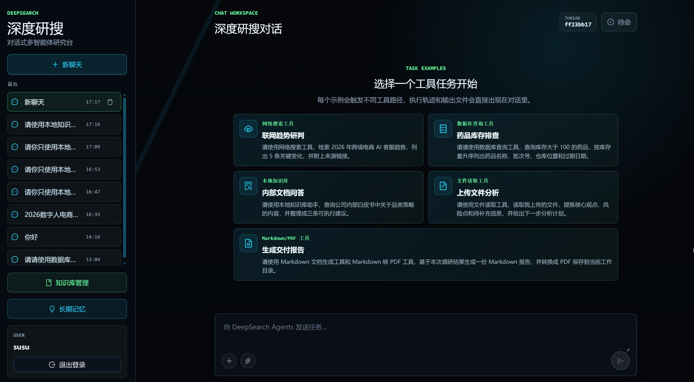

# DeepSearch Agents

<p align="center">
  <a href="#中文">中文</a> | <a href="#english">English</a>
</p>



## 中文

DeepSearch Agents 是一个基于 DeepAgents 的对话式多智能体深度研究系统，支持用户登录、历史会话、短期执行记忆、用户长期记忆、知识库管理、附件读取和多源检索。

### 主要功能

评测当前优先推进 RAG 证据级 A/B/C 实验与少量真实报告验收；复杂 Hybrid 恢复策略冻结为开发诊断路径。E1 已修正零时间阶段启动和普通 Web 任务误占 SQL 恢复预留的问题，并披露重排执行/退化状态。报告评测使用独立 run/session 和配置清单，历史产物会保留。旧 90 题的规则一致性、参考 SQL 可执行性、搜索非空和文件名命中不代表 Agent 答案正确率。见 [评测说明](evals/README.md) 与 [E1 开发记录](docs/development/e1-evaluation-foundation.md)。

- 阶段式深度研究：后端按固定顺序执行“澄清问题与研究简报 -> Supervisor 分派与 researcher 循环 -> 证据压缩 -> 最终报告”。M0.1 已将 Clarify、Compression 和 Writer 改为直接模型调用，只有 Research 阶段保留 DeepAgent。
- 多智能体研究：主智能体负责分派、反思和汇总，通过 `network_search` 子智能体获取公开网页，通过统一 `collect_evidence` 工具获取 SQL、本地文档及 Fee Engine 证据。
- 多源检索：支持 Tavily、DuckDuckGo、Perplexity、SearXNG、MySQL，以及基于 PostgreSQL、Qdrant、MinIO、Redis 和 FastEmbed 的本地 RAG。
- 用户与会话：提供注册、登录、JWT 鉴权、会话列表、历史消息恢复、会话归档和按用户隔离的数据目录。
- 记忆系统：包含当前会话摘要、最近消息上下文、LangGraph 短期 checkpoint，以及可由用户管理的长期记忆。
- 文件处理：支持读取 PDF、Word、Excel、Markdown 和文本附件，并生成 Markdown、PDF 等交付文件。
- 实时任务状态：通过 WebSocket 推送工具调用、子智能体执行、最终结果、异常和取消事件。
- 研究阶段追踪：每个阶段的开始、完成和摘要会写入 WebSocket trace 与审计日志，便于复盘 brief、证据账本、压缩证据和最终报告之间的关系。
- 可复现数据评测：固定 DABStep-Research 数据版本、文件哈希、任务子集和 SQL 参考结果，用于逐步验证数据库分析、证据引用与报告生成质量。
- 确定性费率引擎：用 Decimal 执行 DABStep 逐交易费用规则，计算自然月维度指标，并显式返回匹配状态、规则来源和不确定性，不依赖 LLM。
- 统一证据工具：Fee Engine、只读 SQL 和本地文档检索统一返回带稳定 `evidence_id` 的结构化证据，研究、压缩和写作阶段沿用同一引用键。
- Web 工作台：前端提供聊天、任务事件流、附件上传、知识库管理、长期记忆抽屉、历史会话侧栏和结果下载。
- 审计日志：任务开始、结果、取消、异常等事件会按会话写入 `app/logs/session_*.jsonl`，便于排查执行过程。

### Research Core 开发状态

E4.1 修复否定本地来源约束误触发本地专用判定的问题，并用原两道 Web 题做同预算对照：误触发 2→0，两题均实际进入压缩与 Writer，分别交付 Claim 回退包和报告正文。本轮 6 次查询／6 页，两个运行仍降级且内容初审均为部分回答，安装选择与官方缺失断言仍存在错误。最终代码另补主题／来源区分回归，试跑源码已归档，十题分类分支一致；487 项测试通过、6 项跳过。见 [固定条件对照与剩余问题](docs/development/e4-1-source-intent.md)。

E3.8 已补齐 2 个 Web 与 2 个简单跨源任务，连同 E3.7 共覆盖十个不同开发问题。四题均降级，记录 9 次已准入 Tavily 查询、7 个抓取页面；定位到纯 Web 请求中的否定本地约束被误判为本地专用，导致已有网页证据无法进入正常写作。SQL＋本地题实际查询到 59 个片段，但应用场景回答仍不完整。448 项测试通过、6 项跳过；人工正确率为空。见 [四题实跑、十题总表与下一项改进](docs/development/e3-8-web-cross-source-reports.md)。

E3.7 已在同一干净版本 `33e91f08` 上完成六题本地报告基线：1 正常完成、5 降级；交付为 2 份报告、3 份 Claim 回退包和 1 份零证据说明，中位耗时 95.852 秒。已完成带真实引文的 AI 初审，定位到响应单位误读、跨文档归因、错绑证据片段和政策展望遗漏；人工正确率仍为空。430 项测试通过、6 项跳过，Tavily 为 0。见 [六题结果表与逐题归因](docs/development/e3-7-six-task-local-baseline.md)。

E3.6 新增离线人工标注与最终裁定流程：从已有审核包生成待填 JSON 模板，校验逐段引文、错误类型和修正建议，绑定原报告／Evidence 哈希，再汇总显式裁定。已准备 002／005／006 三份报告的待审批次；当前人工裁定为 0，通过率为空，不将模型意见或待填模板计为验收结果。418 项测试通过、6 项跳过，无模型／搜索调用。见 [操作步骤与统计口径](docs/development/e3-6-human-adjudication.md)。

E3.5 增加本地报告交付前的缺失结论措辞检查：识别到从有限片段扩大为全库／全文不存在内容的明确表达时，拦截正文及引用失败回退稿，返回证据不足说明并标记降级。八份保存报告离线回放中，上一轮负样本的两处表达被拦截，正样本不变；更早负样本仍有措辞漏检。这不是语义验证或通过率，实验路由继续默认关闭。380 项测试通过、6 项跳过，无模型／搜索调用。见 [范围、漏检与回放记录](docs/development/e3-5-local-absence-scope.md)。

E3.4 新增默认关闭的本地索引专用研究路由（评测加 `--indexed-local`）：只声明本地 `collect_evidence`，不提供文件、待办、记忆或子智能体工具，最多接受 2 次补检索。两题对照中不相关工具请求从 13 次变为 0，限额试验耗时约 56／53 秒，但均触发限额降级，负样本仍有无依据的全库断言，因此未替换生产默认。见 [实验与上线门槛](docs/development/e3-4-indexed-local-agent.md)。

E3.3 已将真实本地文件名补入证据账本与 Writer 专用来源清单，并在交付前检查显式 `《文件名.扩展名》`。无法映射到已取回本地证据的文件名会导致正文被拦截，返回来源核验不足说明；引用失败回退稿也不能绕过检查。该规则只验证文件名身份，不证明事实支持、全文核查或文件不存在，别名也可能保守拦截。见 [实现与边界](docs/development/e3-3-local-source-provenance.md)。

旧负样本离线重放中 5 个未核验文件名被拦截，正常对照原文不变；新生成的 002/006 均仍降级，没有触发新的文件名拦截。006 实际触发了此前的零证据边界，返回透明的检索未命中说明，不等于完成拒答语义验收。329 项测试通过、6 项跳过，Tavily 使用量为 0。见 [独立记录](evals/reports/e3-3-source-provenance-2026-10-24.json)。

E3.2 新增保存报告的证据审核入口：核验原报告／Evidence 哈希及语料指纹，生成逐段报告、真实引用片段、文档名待核验项的可读人工复核包；可选模型意见必须通过逐字引文与完整性校验。整报告及逐段试验共 6 次模型审核均超时或无效，未产生可信支持率，当前不建议自动事实验收。已生成 3 份完整人工审核材料，语义验收仍待人工完成，生产 Agent 不变。见 [审核基础与失败记录](docs/development/e3-2-evidence-support-review.md)。

E3.1b 修复 Claim 数组中已知稳定 ID 被一层方括号包装时的误拒绝，保留未知 ID、缺证据及推断边界校验。评测快照额外保存原始结构化 Claim，支持不调用模型或检索的同输入旧规则／新规则重放。该改动只验证引用结构，不等于事实受支持；负样本幻觉与跨文档覆盖仍未解决。见 [策略与重放说明](docs/development/e3-1b-canonical-claim-references.md)。

仅复测 001/002 两题：两题最终引用校验均通过，001 仍因调用预算降级、002 正常完成。对相同的 9 条已保存 Claim 离线重放，旧格式规则拒绝 9 条，新规则结构校验通过 9 条，涉及 14 个已知引用包装；不是答案正确率，也未更新六题总体结果。273 项测试通过、6 项跳过，Tavily 使用量为 0。见 [执行与重放记录](evals/reports/e3-1b-claim-reference-replay-2026-10-19.json)。

E3.1a 已为本地限定任务增加后端强制检索与无证据输出边界：记录 `not_executed`、`error`、`no_evidence`、`evidence`，无本地证据时由后端说明具体状态，不能把未检索或执行失败写成“文档不存在”。检索占用原研究预算，不增加总时限；Agent、Claim 校验及检索参数保持不变。见 [开发记录](docs/development/e3-1a-required-local-retrieval.md)。

同一组 6 题实跑后，有答案题零取证从 2/5 降到 0/5；仍有 3 题降级，跨文档证据覆盖不完整。无答案题补检索取得无关片段后仍出现无依据的文档目录描述，因此“有 Evidence／运行完成”不是报告合格。使用量为 0 次 Tavily；人工验收仍待完成。见 [前后对照](evals/reports/e3-1a-local-retrieval-2026-10-19.json)。

E3.1 新增 6 个真实本地报告开发任务，保存实际报告、完整 Evidence、引用 ID 核验、参考证据覆盖与人工复核表。报告验收不再以“生成文件”代替事实正确；答案要点、证据支持及无答案拒答仍待人工审核。此阶段搜索/抓取预算均为 0；2 个 Web 与 2 个简单跨源报告留待后续 E3。见 [报告验收](evals/reports_acceptance/README.md) 和 [开发记录](docs/development/e3-1-local-report-acceptance.md)。

首轮 6 题均生成了非空文件和证据快照，但 5 题降级，唯一标为 `completed` 的跨文档题没有实际获取 Evidence。因此不能声称报告验收通过；下一步优先修复“未检索/检索失败被写成文档不存在”的边界。零 Tavily 查询，完整结果见 [基线摘要](evals/reports/e3-1-local-reports-2026-10-18.json)。

E2 已建立 20 条 RAG 开发题与 10 条新查询测试题的 v2 标注草案及冻结协议。首轮五题曾因漏标等价段落低估 BGE；仅对同一批已保存片段重评分，C 的锚点 Recall@5 即从 0.25 变为 1.00，不能把该变化当作模型改善。原始记录保留，v2 固定数据、语料、模型文件及检索配置，标注仍待人工审核。命令、结果与限制见 [RAG 实验](evals/rag/README.md) 和 [v2 分析](docs/development/e2-rag-suite-v2.md)。

v2 已完成全部 90 次配置运行：A/B/C 的证据 Recall@5 在 19 条有答案开发题上为 0.158/0.500/0.675，在 8 条有答案测试题上为 0.625/0.500/0.875。3 条无答案题单独记录；上述结果是待人工复核的段落检索指标，不代表答案正确率。多文档完整覆盖仍有缺口，下一阶段进入真实报告与证据支持验收。

M0 已完成运行级 Budget、结构化 Trace 和端到端 baseline 支持。每次执行都会在会话目录写入 `research_trace.json`，记录阶段耗时、LLM/工具调用、Token、搜索使用量、Waste 和失败原因。

2026-08-17 的首轮 M0 baseline 执行了 5 个纯 Web 报告样本，另外 5 个 MySQL 样本因本地数据库未启动而阻塞。5 个实际执行的样本全部降级，且没有生成要求的 Markdown 文件。Trace 定位到三个直接原因：Clarify 阶段仍可调用 DeepAgents 内建工具并全部超时，Supervisor 声称生成了实际不存在的文件，以及全局 LLM 调用预算在 Compression/Writer 完成前耗尽。

M0.1 稳定性修复现已实现并完成首轮复测。5 个 Web 样本的 Clarify 都缩减为 1 次模型调用，平均 LLM 调用从 19.8 次降到 9.2 次，平均输入 Token 从约 176k 降到约 76.8k。后端为 5 个样本都写入了非空 `report.md`，其中 1 个任务正常完成，4 个任务仍因 Supervisor 或 Compression 超时而降级。P95 从 208.3 秒升到 216.6 秒，尚未达到 180 秒目标。

本轮还发现三个待修复问题。评测提示中的 `convert_md_to_pdf` 工具名称触发了格式误判，导致 Markdown-only 样本额外生成 PDF；Supervisor 仍会调用 DeepAgents 内建的 `write_todos`、`write_file` 和 `read_file`；最终报告中的 URL 与审计日志记录的搜索结果没有精确重合，部分链接带有明显的占位符特征。因此文件交付已经稳定，但报告证据质量尚未达标。当前 `evals/results/report_eval.json` 仍是旧的 M0 汇总，本轮数据来自 5 份新生成的 schema v2 Trace。完整记录见 [M0 development log](docs/development/m0-baseline-budget-trace.md)。

### DABStep 数据基线

项目已加入第一阶段结构化数据研究基线，使用 `RUC-DataLab/DABStep-Research` 的固定提交 `62ae9e0de555a8fb1fd5ab334e0546dbf27aa10c`。`evals/dabstep/dataset.lock.json` 记录 8 个源文件的字节数和 SHA-256，下载器会在使用前逐一校验，防止上游更新导致评测结果漂移。

数据审计确认：任务共 100 个、五类各 20 个，但 Open 类 20 个任务全部没有 checklist；交易表包含 138,236 笔交易和 5 个活跃商户，商户元数据包含 30 行；1,000 条费率规则中同时使用 `null` 和空列表表达通配条件，并引用了 7 个 MCC 参考表中不存在的代码。完整结论见 [DABStep 数据审计](evals/dabstep/AUDIT.md)。

第一阶段固定 8 个原始任务：dev 使用 ID 2、84，holdout 使用 ID 0、3、20、41、47、85。只允许用 dev 调整 prompt、工具和工作流；holdout 用于里程碑验收。任务原文和 checklist 保持不变，附加字段只记录 split、可回答性、限制和必须核验的参考查询。

一条命令可完成固定版本下载、哈希验证、审计产物生成、最小 SQL 导入和参考结果核验：

```powershell
.\.venv\Scripts\python.exe -m evals.dabstep.prepare
```

默认生成本地 SQLite 数据库，不需要启动基础设施；也可以通过 `DABSTEP_DATABASE_URL` 使用 MySQL SQLAlchemy URL。导入器创建交易、商户、收单机构、MCC、费率规则及其规范化关联表。6 组只读参考查询覆盖数据规模、缺失值、商户汇总、卡组织、境内/跨境路由和表行数。`reference_results.json` 仅供离线 evaluator 使用，不应暴露给研究 Agent。原始数据与工作数据库均被 Git 忽略。

M1.1 Fee Rule Engine 已实现为不依赖 LLM 的确定性内核，使用 Decimal 执行逐交易公式，按自然月计算商户交易额和欺诈金额比例，并为每个费用组件返回规则 ID、匹配条件、通配条件和 `fees.json#ID=<id>` 定位。结果状态为 `MATCHED`、`NO_MATCH`、`AMBIGUOUS_SEMANTICS`、`INVALID_SOURCE_DATA` 或 `UNSUPPORTED_RULE`，调用方可以区分真实零费用、未覆盖数据和规则语义风险。

在当前固定数据版本上，引擎对 138,236 笔交易全部给出状态：81,772 笔匹配至少一条规则，已匹配覆盖范围的费用合计为 €95,213.255747；56,464 笔明确标记为 `NO_MATCH`，不会被静默伪装成已验证的零费用。

交叉验证包括 6 个 Adyen DABstep 公开 dev 硬检查和 500 个由独立 SQLite 查询重新匹配的多样化交易样本，规则 ID 与费用金额均无差异。公开 task 2697 的官方答案无法按手册逐交易公式复现，且上游讨论区已有同类质疑，因此被记录为已知上游真值争议，不计入硬检查。`fee_reference_results.json` 只供 evaluator 使用。

如果数据已经下载，可以单独复验费率引擎和已提交的参考结果：

```powershell
.\.venv\Scripts\python.exe -m evals.dabstep.validate_fee_engine --no-download
```

M1.2 已把 Fee Engine、MySQL 和本地知识库检索统一到 `collect_evidence`。工具返回 schema v1 的 `EvidenceBatch`，每条 `EvidenceRecord` 都包含 `evidence_id`、`source`、`locator`、`content` 和 `metadata`。ID 由规范化来源身份和内容摘要生成，不依赖运行时间、检索排名或模型输出：相同 SQL 行、相同文档分块或相同费用计算在重复执行时保持同一 ID；来源内容变化则生成新 ID。

三个来源分别使用不同的可追溯定位方式：SQL 记录绑定数据库身份、规范化查询摘要和行内容摘要；本地文档绑定文档 SHA-256 与 chunk index；费用证据绑定数据集指纹、`psp_reference` 和 `fees.json#ID=<id>` 规则 provenance。SQL 仅允许只读语句，在只读事务内执行并受行数预算限制；本地文档直接返回检索片段，不再先经过一次问答模型改写。

| `source` | 必填输入 | 稳定定位依据 | 主要边界 |
| --- | --- | --- | --- |
| `fee_engine` | `psp_reference`；可选 `aci` | 数据集指纹、交易号、命中规则 ID | 只处理已加载固定数据中的交易；`NO_MATCH` 仍作为可追溯证据返回 |
| `sql` | 只读 `query`，或 `operation=list_tables` | 数据库身份、规范化 SQL 摘要、行内容摘要 | 禁止写语句和多语句；结果受 `DB_QUERY_PREVIEW_ROWS` 限制 |
| `local_document` | `query`；可选 `knowledge_base` | 文档 SHA-256、chunk index、内容摘要 | 依赖已完成索引的本地知识库；结果可能因上下文预算标记为 `PARTIAL` |

应用代码也可以直接调用同一工具：

```python
import json

from app.tools.evidence_tool import collect_evidence

payload = json.loads(
    collect_evidence.invoke(
        {
            "source": "fee_engine",
            "psp_reference": "20034594130",
        }
    )
)
for record in payload["records"]:
    print(record["evidence_id"], record["locator"])
```

返回批次状态为 `OK`、`NO_EVIDENCE`、`PARTIAL` 或 `ERROR`。错误和截断通过 `warnings` 显式返回，不会生成伪造的证据记录。除默认单元测试外，M1.2 现在包含 4 项显式启用的真实基础设施验收：Qdrant 客户端/服务端兼容性、MySQL 只读与稳定 ID、固定 DABStep Fee Evidence，以及跨 PostgreSQL/Qdrant 的本地文档稳定检索。当前开发环境已全部通过；复验命令与失败解释见 [`docs/development/m1-2-live-infrastructure.md`](docs/development/m1-2-live-infrastructure.md)。

最小研究工作流现在要求 Supervisor 只通过 `collect_evidence` 获取这三类内部证据，并在 Evidence Ledger 中原样保留 `evidence_id`。证据压缩和最终报告继续引用 `[evidence_id]`，从而可以从报告追溯到具体 SQL 行、文档片段或费用计算。网络检索仍由独立助手负责，尚未纳入 M1.2 的统一内部证据 schema。Fee 来源默认自动发现唯一的固定 DABStep 快照；存在零个或多个快照时，应通过 `DABSTEP_DATA_DIR` 明确指定目录。

M2.1 在此基础上加入后端强制的 Claim→Evidence 协议。压缩模型不再分别输出 `core_findings` 和 `citations` 字符串列表，而是提交包含 `text`、`evidence_ids`、`kind` 和 `limitations` 的 Claim 草稿。后端只接受引用本轮真实已收集 ID 的 Claim；无证据、未知 ID，以及没有说明限制条件的 inference 会进入 `Rejected claim drafts`，不会作为已验证结论交给 Writer。通过校验的 Claim 获得稳定 `clm1_...` ID。

最终报告生成后还会执行确定性引用检查：Writer 只能引用已接受 Claim 中的 `[evidence_id]`；若引用未知 ID，或在已有有效证据时完全省略引用，后端会拒绝该 Writer 结果、把运行标记为 degraded，并返回经过验证的 Claim Package。Trace schema v3 引入接受/拒绝 Claim 数、证据使用率和最终引用状态；当前 schema v5 在此基础上包含隐私安全的 SQL 修复与 SQL-only 修正指标，仍不复制私有证据正文。完整设计与失败行为见 [`docs/development/m2-1-claim-evidence-validation.md`](docs/development/m2-1-claim-evidence-validation.md)。

M2.2 将成功抓取并解析的公开网页正文接入同一证据链。网络搜索结果先标记为候选；只有 `fetch_full_page=true` 且正文抓取成功的页面才会生成稳定 `ev1_web_...`，并进入 Trace、Claim 校验和最终引用门禁。只有标题、URL 或搜索摘要的 `CANDIDATE_ONLY` 结果不属于证据。Web ID 基于规范化 URL 和正文内容寻址，不受排名分数、查询词、搜索后端或跟踪参数变化影响；网页实质内容变化会生成新 ID。详见 [`docs/development/m2-2-web-evidence.md`](docs/development/m2-2-web-evidence.md)。

M3.1 增加 HybridDeepResearch 三题 smoke 适配：三种 SQL/Web 协同模式各选一题，并统一使用一个只读 SQLite 数据库。默认 DuckDuckGo，每题最多两个查询和两个抓取页面，完整运行最多六个查询；任何可能使用 Tavily 等付费额度的模式都必须显式授权。加密题目只在内存解密，结果文件不保存问题、参考答案、SQL 或模型正文。该子集用于发现跨来源链路故障，不代表官方 benchmark 成绩。复现方法见 [`evals/hybrid/README.md`](evals/hybrid/README.md)。

M3.2 完成首次真实 smoke baseline，并据此修复两项执行链缺陷：搜索后端现在使用工具层硬锁，模型不能以 `advanced` 绕过 DuckDuckGo 限制；后端还会维护不写入 telemetry 的有界 Evidence Ledger，即使 Supervisor 没有生成摘要，Compression 仍能收到真实证据。修复后 3/3 报告通过引用校验、2/3 收集到 SQL+Web 双源证据，但严格答案正确率仍为 0/3。当前瓶颈是 SQLite schema 探索和受限预算内的 SQL 修复，而不是搜索数量。完整基线见 [`docs/development/m3-2-hybrid-smoke-baseline.md`](docs/development/m3-2-hybrid-smoke-baseline.md)。

M3.3 为 SQLite Evidence 增加确定性的 schema discovery。`describe_schema` 一次返回表、字段类型、主键、外键和索引的稳定 `ev1_sql_...` Evidence；`sample_table` 只接受 catalog 中的精确表名，并最多返回三行用于判断值域。两者均通过只读连接、查询超时和固定上限约束。冻结的 `alien` 数据库可一次发现全部 11 张表，评测提示词现在要求先查看 schema 再编写 SQL。实现与边界见 [`docs/development/m3-3-sqlite-schema-discovery.md`](docs/development/m3-3-sqlite-schema-discovery.md)。

M3.4 在 Evidence Tool 边界执行 SQL 修复上限：首次失败后只允许一条不同的修复 SQL，原样重复会被拒绝；若修复仍失败，后续查询不会触达数据库。成功查询会重置连续失败计数。Trace schema v4 只保存查询摘要、成功/失败/拦截数量和有限错误类别，不保存 SQL 或数据库错误正文；Hybrid smoke 汇总也暴露这些指标。详见 [`docs/development/m3-4-bounded-sql-repair.md`](docs/development/m3-4-bounded-sql-repair.md)。

M3.5 将 Hybrid smoke 从 180 秒的 `standard` 档调整为 300 秒的 `deep_report` 档，以避免慢模型在首次研究工具调用前耗尽 Supervisor 的 90 秒窗口。每题搜索与页面上限仍为 2、研究轮次仍为 1、付费后端仍需显式授权，因此增加的是模型执行时间而不是外部检索额度。详见 [`docs/development/m3-5-hybrid-phase-budget.md`](docs/development/m3-5-hybrid-phase-budget.md)。

M3.6 修复“发现证据冒充分析证据”的语义漏洞。表清单和 schema 标记为 `database_schema`，三行预览标记为 `database_sample`，它们可帮助构造查询但不能支撑最终 Claim；只有显式 `operation=query` 的 `query_result` 才能进入 Claim 校验。Hybrid 任务若没有成功的分析 SQL，会记录 `analytical_sql_evidence_missing` 并以证据缺口降级。该门来自一次单题复验：schema 1 次、样例 3 次、DuckDuckGo 2/2、分析 SQL 0 次、严格答案仍错误，且未授权或使用 Tavily。详见 [`docs/development/m3-6-analytical-sql-evidence-gate.md`](docs/development/m3-6-analytical-sql-evidence-gate.md)。

M3.7 在 M3.6 门禁前加入一次受限的 SQL-only 修正：仅当任务明确要求分析型 SQL、已经取得真实 schema/sample Evidence、仍没有 `query_result`，且 SQL 连续失败上限尚未耗尽时触发。该阶段只有一次模型调用，只绑定 `collect_evidence`，后端只接受 `source=sql, operation=query` 的单次调用；网络搜索、子智能体、重复 schema/sample 和其他 Evidence 来源均不可用。它不消耗 research round，也不提高查询或页面上限。Trace schema v5 与 Hybrid 汇总记录修正尝试和成功次数。详见 [`docs/development/m3-7-sql-only-correction.md`](docs/development/m3-7-sql-only-correction.md)。

M3.8 根据两次 `s2sql_041` 真实复验强化修正执行。首次运行没有发生 Web 搜索，且模型未主动发起修正工具调用；第二次使用 Tavily 的运行严格消耗 2 个查询和 1 个抓取页面，恢复了 Web+SQL 双源 Evidence 与有效引用，但结构化修正在 45 秒超时。当前实现不再依赖模型选择工具，而是要求输出一个 `SQLCorrectionProposal`，再由后端固定执行唯一一次只读 SQL Evidence 调用；修正上下文优先排列 Web Evidence，并完整容纳冻结数据库约 24k 字符的 schema，独立上限调整为 60 秒。详见 [`docs/development/m3-8-structured-sql-correction.md`](docs/development/m3-8-structured-sql-correction.md)。

M3.9 修复连续 SQL 失败会在结构化修正开始前关闭 gate 的问题。一次新的 `s2sql_041` 复验严格使用 2 次 Tavily 查询和 2 个页面，收集了双源 Evidence，但 Supervisor 最后两条 SQL 都因未知字段失败，导致仍有约 90 秒总预算时修正次数仍为 0。现在后端为 `sql_evidence_correction` 保留一个独立恢复槽：它可以越过已经耗尽的连续失败额度，但不能重复任何失败 SQL，并继续经过只读、单语句、超时和结果上限校验；普通 Supervisor 的修复额度、Web 限额和研究轮次都不增加。Trace schema v6 新增恢复准入计数。详见 [`docs/development/m3-9-reserved-sql-correction.md`](docs/development/m3-9-reserved-sql-correction.md)。

M3.10 根据 M3.9 后的真实复验增加一次 error-only SQL repair。该次 `s2sql_041` 使用 2 次 Tavily 查询和 1 个页面，修正阶段已在约 4 秒内进入并返回 SQL，但把派生指标误写成 schema 中不存在的物理字段。现在只有首条修正 SQL 返回 `ERROR` 时，后端才允许第二条不同的结构化提案；空结果不会触发盲目重试。两个提案和工具执行共享原 60 秒 deadline，仍保留只读、去重、单语句、数据库超时与 writer/compression 预算，也不增加 Web 或研究轮次。Trace schema v7 新增修正 repair 的尝试与成功计数。详见 [`docs/development/m3-10-error-aware-sql-correction.md`](docs/development/m3-10-error-aware-sql-correction.md)。

M3.11 修复“已有分析 SQL Evidence，但最终回答没有 SQL block”的输出链路缺口。一次新的 `s2sql_041` 复验使用 2 次 Tavily 查询和 2 个页面，3 条分析 SQL 全部成功、产生 5 条 `query_result` Evidence 且引用校验通过，但评测器因没有可执行 SQL block 必然判错。现在运行时私下保存 Evidence ID 到实际执行 SQL 的映射，优先选择支持已接受 Claim 的查询；调用方显式设置 `INCLUDE_EXECUTED_SQL_IN_REPORT=1` 时，后端会移除模型生成的 SQL fence，并附加唯一一条真实执行查询。SQL 正文仍不进入 trace。Trace schema v8 增加附加状态指标。详见 [`docs/development/m3-11-executed-sql-output.md`](docs/development/m3-11-executed-sql-output.md)。

M3.12 根据 M3.11 后的真实复验补充空结果修正。该次 `s2sql_041` 严格使用 2 次 Tavily 查询和 2 个页面，取得双源 Evidence 并通过引用校验，但结构化修正 SQL 因过度收紧的位置过滤返回 `NO_EVIDENCE`，因此没有可附加的执行 SQL。现在首条修正查询返回 `ERROR` 或 `NO_EVIDENCE` 时都可使用既有的第二个提案槽；空结果提示只允许放宽 Evidence 无法支持的过滤条件，同时保留目标实体与计算要求。两次提案继续共享 60 秒 deadline，第二次仍为空就停止，且不增加 Web 搜索、页面或研究轮次。Trace schema v9 新增空结果修正的尝试与成功计数。详见 [`docs/development/m3-12-empty-result-sql-repair.md`](docs/development/m3-12-empty-result-sql-repair.md)。

M3.13 为真实评测增加显式且有硬上限的检索预算覆盖。M3.12 后的 `s2sql_041` 复验实际使用 2 次 Tavily 查询和 2 个页面，成功取得双源及分析型 SQL Evidence、通过引用校验并附加真实执行 SQL，但两个网页不足以完成实体解析，严格 SQLite 结果仍不等价。冻结子集默认值继续保持 2/2；评测人员可以通过 `--max-search-queries` 和 `--max-fetched-pages` 单独覆盖，每项每任务最多 10。结果 JSON 会披露有效限额及是否覆盖，付费搜索仍必须另行显式授权。详见 [`docs/development/m3-13-evaluation-retrieval-overrides.md`](docs/development/m3-13-evaluation-retrieval-overrides.md)。

M3.14 修复模型供应商超时直接终止整个研究工作流的问题。首次 6/6 诊断实际使用 5 次 Tavily 查询、抓取 3 个页面，并保留了 Web Evidence 与 SQL schema，但 Supervisor 在约 145 秒时抛出 `APITimeoutError`；当时总预算仍剩约 155 秒，却未进入 SQL correction、压缩或写作。现在工具阶段会识别内置及供应商包装的 timeout 异常，将阶段标记为 `budget_exceeded/upstream_timeout`，保留已收集 Evidence 并继续后续阶段；其他未知异常仍然抛出。Trace schema v10 新增恢复计数。详见 [`docs/development/m3-14-upstream-timeout-recovery.md`](docs/development/m3-14-upstream-timeout-recovery.md)。

M3.15 根据 M3.14 后的 6/6 单题复验补齐固定 SQL 语义上下文。该次运行完整执行所有阶段，但 7 次 SQL 中 5 次为空、2 次修正因把派生指标误作物理字段而失败。Hybrid runner 现在挂载已锁定并校验哈希的列含义与领域公式 sidecar：`describe_schema` 合并物理字段的业务含义，`search_semantic_knowledge` 最多返回 8 条稳定的公式发现 Evidence，后端 SQL correction 也会自动预取。schema、样例和公式仍是 discovery-only，不能替代成功的分析型查询支撑 Claim。Trace schema v11 新增语义字段和检索计数；实现阶段未额外使用 Tavily。详见 [`docs/development/m3-15-pinned-sql-semantics.md`](docs/development/m3-15-pinned-sql-semantics.md)。

M3.16 根据 M3.15 后的真实复验将语义加载和 Compression 交接改为后端确定性行为。本次 6/6 Tavily 运行实际使用 6 次查询、5 个页面；5 条分析 SQL 全部成功并附加了真实执行 SQL，证明 M3.15 已消除未知字段失败。但 Supervisor 没有主动检索公式，Compression 又引用了 5 个 discovery-only schema ID，导致 6 条 Claim 全部被拒绝。现在后端会在 Supervisor 前自动预取匹配公式；Compression 只接收由运行时按 `claim_eligible_evidence_ids` 重建的 Evidence Ledger，不再接收未经验证的 Supervisor 引用或 schema/sample/formula ID。详见 [`docs/development/m3-16-deterministic-semantic-handoff.md`](docs/development/m3-16-deterministic-semantic-handoff.md)。

M3.17 修复固定公式只检索顶层定义、没有展开依赖的问题。M3.16 后的单题运行虽然授权了 Tavily 6/6，但实际没有发起网络搜索；两次语义预取均成功，Compression 的未知 Evidence ID 从 5 降为 0，但顶层公式的两个 `children_knowledge` 未返回，其余位置被词面重叠条目占用，修正 SQL 仍把派生指标当成物理字段。现在精确名称命中会优先按依赖图展开，再使用剩余上限；每条公式还会返回 `resolved_columns` 和 `relevant_table_columns`，把公式标识符确定性映射到只读 SQLite 的真实表和字段。锁定数据的离线核验准确返回 1 个父公式及 2 个依赖，并完成跨两个相关表的字段落地。详见 [`docs/development/m3-17-semantic-dependency-closure.md`](docs/development/m3-17-semantic-dependency-closure.md)。

M3.18 根据 M3.17 后的真实复验压缩 SQL correction 上下文并修复 fallback 引用状态。本次 Tavily 6/6 运行实际使用 6 次查询、5 个页面，取得 5 条 Web Evidence、6 条 accepted Claims、0 条 rejected Claims 和 0 个未知 Evidence ID；但 3 条 SQL 均为空结果，correction 的结构化模型调用又耗尽 60 秒。原因之一是任务省略了指标名末尾的缩写括号，检索退回 8 条词法结果；同时 correction 重复携带庞大全库 schema。现在完整名称不带缩写也视为精确命中，只返回父公式与必要依赖；有公式时 correction 只接收 16k 公式映射和 16k Web-first claim context。Writer 漏写 Evidence ID 时，后端还会重新校验实际返回的 validated Claim fallback，使 trace 反映交付内容的真实引用有效性。详见 [`docs/development/m3-18-compact-sql-correction-and-citation-fallback.md`](docs/development/m3-18-compact-sql-correction-and-citation-fallback.md)。

M3.19 根据 M3.18 后的 6/6 单题复验补齐跨源实体落地。该次运行取得 6 条 Web Evidence、4 条 accepted Claims、有效的交付引用以及稳定的 3 条公式记录，但 Supervisor 把单条线索中的地点误当成最终实体，两条 SQL 因错误过滤值返回空结果，correction 随后再次耗尽 60 秒。网络 researcher 现在必须逐条核验线索并以候选交集收敛实体。SQLite Evidence 新增 `match_column_value`：在校验真实表列后，以参数化只读查询返回有界、稳定的 `database_value_match`，区分零匹配、多匹配和唯一匹配，并通过 `comparison_mode` 明确固定宽度字段是否必须使用 `TRIM`。该 Evidence 只用于发现和 SQL 构造，不能直接进入 Claim；correction 会保留它与公式映射。本阶段没有再次消耗 Tavily。详见 [`docs/development/m3-19-entity-value-grounding.md`](docs/development/m3-19-entity-value-grounding.md)。

M3.20 修复 Supervisor 在 SQL 前结束时，已经落地到真实表列的公式 Evidence 仍无法启动 correction 的门禁缺口。M3.19 后首次 Tavily 6/6 复验取得 6 条 Web Evidence、5 条有效 Claim 和 3 条公式记录，但约 177 秒后仍是 0 次 SQL、0 次 correction。现在只有同时包含非空 `resolved_columns` 与 `relevant_table_columns` 的 `database_semantics` 才可与 schema/sample 一样证明数据库已被发现；普通未落地语义不能打开门禁。修复后的 6/6 复验使用 6 次查询和 5 个页面，在约 98 秒内进入 1 次 correction 并执行 2 条不同的只读 SQL，后续压缩和写作均完成且引用有效。两条 SQL 仍因模型把派生指标写成物理字段而失败，因此下一瓶颈已收敛为提案校验或确定性公式展开，而非流程准入或超时。详见 [`docs/development/m3-20-semantic-correction-admission.md`](docs/development/m3-20-semantic-correction-admission.md)。

M3.21 将公式 Evidence 从“模型可阅读”升级为“后端可执行”。受限编译器会递归展开依赖，支持四则运算、比较、三元条件及固定的 LaTeX `text/times/frac` 形式，把每个标识符唯一映射为真实 `table.column`，并生成 `compiled_sql_expression` 与 `required_tables`；歧义、缺失、循环或不支持的公式会安全地保持不可执行。SQLite Evidence 同时新增 `validate_query`，在只读连接上使用 `EXPLAIN QUERY PLAN` 预检 correction 提案。未知字段会使用原有唯一 repair 槽返回模型修正，但不会消耗分析 SQL 尝试或累计数据库失败。锁定 alien 数据的离线核验成功把目标公式展开到 `observatories` 与 `telescopes`，预检通过并取得真实查询结果；本阶段不消耗 Tavily。详见 [`docs/development/m3-21-executable-sql-semantics.md`](docs/development/m3-21-executable-sql-semantics.md)。

M3.22 将跨源多线索实体解析从提示词约定提升为 SQL correction 前的后端门禁。明确包含 `clue`、`clues` 或“线索”的任务必须先返回结构化 `EntityResolutionProposal`：至少两条线索都要指向同一候选，每条线索引用的 ID 必须属于当前运行中真实抓取的 Web Evidence，目标表列必须来自已落地的语义目录；随后 `match_column_value` 还必须在数据库中得到唯一值。缺失线索、伪造 ID、候选冲突、虚构表列、零匹配或多匹配都会安全停止，不能进入分析 SQL。Trace schema v12 与 Hybrid 汇总新增实体解析和唯一值落地计数。离线集成测试覆盖成功链路与伪造 Web ID 拒绝，全量结果为 175 passed、6 skipped；本阶段不消耗 Tavily。详见 [`docs/development/m3-22-structured-entity-resolution.md`](docs/development/m3-22-structured-entity-resolution.md)。

M3.23 修复 M3.22 首次真实复验暴露的 Web Evidence 类型契约错位。首轮 Tavily 6/6 运行实际使用 6 次查询、5 个页面，已有 5 条 Web Evidence 和 3 条语义 Evidence，却因生产 adapter 未写 `evidence_kind=web_page` 被实体账本全部过滤，错误报告 `context_missing`。现在 adapter 显式标型，runtime 也会把缺少该字段的旧式 `source=web` record 兼容归一为 `web_page`；metadata 不参与稳定 ID，现有 `ev1_web_...` 不会变化。修复后的 6/6 复验收集 6 条 Web Evidence，失败推进为真实的结构化 `unverified`，证明上下文已进入解析器。后端进一步把拒绝细分为不泄露内容的固定类别，包括线索不完整、候选冲突、未知 Evidence ID 和越界表列。全量测试为 176 passed、6 skipped；两次真实运行均未超过单次 6/6，且没有启动第三次付费测试。详见 [`docs/development/m3-23-web-evidence-kind-contract.md`](docs/development/m3-23-web-evidence-kind-contract.md)。

M3.24 修复网络 researcher 的机器路由名与本地化展示名混用。M3.23 后的首次 6/6 诊断在 clarification 超时，重试则在 Supervisor 以 `subagent_not_allowed:network_search` 停止；两次均为 0 次搜索、0 个页面，没有消耗 Tavily credits。根因是 DeepAgents `task.subagent_type` 使用稳定英文 token，而后端白名单来自 YAML 中文名称。现在注册名固定为代码所有的 `network_search`，中文名称只保留在 description；合法调用能够继续完成阶段，`general-purpose` 等未配置类型仍在执行前拒绝，调用上限不变。全量测试为 178 passed、6 skipped，本阶段未启动修复后的付费复验。详见 [`docs/development/m3-24-stable-network-subagent-route.md`](docs/development/m3-24-stable-network-subagent-route.md)。

M3.25 修复锁定 SQLite 资产在 Windows managed workspace 中的严格 realpath 权限错误。M3.24 后的真实 6/6 运行证明 `network_search` 已恢复：实际使用 6 次查询、5 个页面并生成 5 条 Web Evidence；但所有 SQL Evidence 因 `Path.resolve(strict=True)` 返回 `WinError 5`，最终为 0 条 SQL/语义 Evidence。数据库、列含义 JSON 和公式 JSONL 现在统一采用非严格规范化后显式 `is_file`/`stat` 校验，SQLite 仍保持 `mode=ro`、`query_only`、超时和只读 SQL 限制。Hybrid runner 还会在调用 Agent 和任何付费检索前，通过生产 Evidence 路径预检 schema 与语义 sidecar；失败时不会进入 `run_deep_agent`。锁定 `alien` 资产预检已在 Windows 上通过，全量测试为 180 passed、6 skipped；本阶段未进行修复后的第二次 Tavily 运行。详见 [`docs/development/m3-25-windows-sql-evidence-preflight.md`](docs/development/m3-25-windows-sql-evidence-preflight.md)。

M3.26 根据 M3.25 后的真实单任务复验，把下一瓶颈收敛到“多线索网页覆盖不完整”。该次 6/6 上限运行实际使用 4 次 Tavily 查询和 4 个页面，成功取得 14 条 SQL Evidence（其中 3 条语义 Evidence）与 4 条 Web Evidence，双源检查和引用校验均通过；实体门禁随后以 `sql_entity_resolution_clues_unsupported` 安全停止，没有猜测实体或执行分析 SQL。现在网络 researcher 必须先为每条未覆盖线索分别查询，预算有余量时才做候选交集查询；预算不足则优先补缺口，禁止以宽泛国家、族群或地区背景替代具体人物、建筑、作品或事件线索。子智能体还必须返回逐条 `Clue Coverage`，只有每条线索都绑定真实抓取的 `ev1_web_...` 才能声称共同实体已核验。现有搜索硬上限和 M3.22 实体门禁保持不变，本阶段不进行第二次 Tavily 运行。详见 [`docs/development/m3-26-clue-complete-web-retrieval.md`](docs/development/m3-26-clue-complete-web-retrieval.md)。

M3.27 将 M3.26 后仍然出现的线索缺口从提示词问题提升为后端可控恢复。真实 6/6 复验通过预检并用满 6 次查询和 6 个页面，4 次 network subagent 调用取得 6 条 Web Evidence，连同 14 条 SQL Evidence 完成双源与引用校验，但约 164 秒后仍以 `sql_entity_resolution_clues_unsupported` 停止。现在多线索任务会为实体恢复预留最后 2 次查询和 2 个正文页面，普通 Supervisor 搜索最多先使用 4 次查询/4 个页面；首次结构化解析只有在明确返回 `clues_unsupported` 和至多 2 条具体 `recovery_queries` 时，后端才释放预留额度、抓取正文并在产生新 Web Evidence 后重试一次。其他拒绝类型、空查询或无新增 Evidence 都不会重试。总搜索硬上限、当前运行 Evidence ID 校验、候选一致性、表列目录和唯一数据库值门禁均保持不变；本阶段不进行修复后的第二次 Tavily 运行。详见 [`docs/development/m3-27-reserved-entity-evidence-recovery.md`](docs/development/m3-27-reserved-entity-evidence-recovery.md)。

M3.28 修复 M3.27 恢复链在“Supervisor 完全没有产生 Web Evidence”时无法启动的问题。首次 M3.27 后复验通过 SQLite/语义预检，但 Supervisor 未分派网络 researcher，因而实际使用 0 次 Tavily 查询和 0 个页面；流程保留 14 条 SQL Evidence 后，在约 28 秒处以 `sql_entity_resolution_context_missing` 停止，预留的 2/2 恢复容量没有机会使用。现在只有缺少语义表列目录才会立即报告 context missing；空 Web Ledger 会进入第一次结构化解析，并被明确要求返回 `all_clues_supported=false`、禁止猜测实体、只提供定向恢复查询。后端取得新 Web Evidence 后才允许第二次解析。既有的线索完整性、真实当前运行 Evidence ID、候选一致性、表列目录和数据库唯一值门禁均未放宽。聚焦测试同时覆盖部分 Web 与零 Web 启动，共 43 passed；本阶段不进行修复后的 Tavily 重跑。详见 [`docs/development/m3-28-zero-web-entity-recovery.md`](docs/development/m3-28-zero-web-entity-recovery.md)。

M3.29 修复恢复查询有页面额度却无法用后续候选回填抓取失败的问题。M3.28 后真实 6/6 复验首次完整验证了 4 次普通查询 + 2 次后端恢复查询、2 次实体解析、14 条 SQL Evidence、3 条 Web Evidence、6 条有效 Claim 和有效引用；但第二次解析仍以 `sql_entity_resolution_clues_unsupported` 停止，且 6 个页面额度只取得 3 个正文页面。根因是搜索工具把候选数直接压缩为剩余页面数，两个恢复候选中只要一个抓取失败，就没有后续候选补位。现在 `SearchRequest` 将候选上限与成功正文页上限分离；抓取器按剩余成功槽位分批执行，空正文才继续下一候选，达到上限立即停止。恢复阶段最多查看 6 个去重候选，但仍只能保留 2 个成功页面，总 6/6 硬上限不变。本阶段不进行修复后的 Tavily 重跑。详见 [`docs/development/m3-29-bounded-page-fetch-backfill.md`](docs/development/m3-29-bounded-page-fetch-backfill.md)。

M3.30 修复候选回填在释放预留额度后只看到全局剩余页面数、因而突破恢复阶段局部 2 页上限的问题。M3.29 后真实复验中 Supervisor 使用 0 次网络检索，后端恢复使用 2 条查询并从 6 个候选保留了 3 个正文页面；全局 6/6 仍合规，但恢复阶段超过了自己的 2 页预算，第二次解析仍以 `sql_entity_resolution_clues_unsupported` 停止。现在 `research_search` 支持调用级 `max_fetched_pages`，有效值始终取调用请求与当前运行可用额度的较小者；调用者只能收紧、不能扩大运行预算，监控同时记录请求值和解析值。实体恢复显式传入释放的 2 页额度，因此仍可用 6 个候选回填失败，但最多保留 2 个正文页面。聚焦测试 55 passed；本阶段不进行修复后的 Tavily 重跑。详见 [`docs/development/m3-30-per-call-page-cap.md`](docs/development/m3-30-per-call-page-cap.md)。

M3.31 为实体恢复检索后的第二次结构化解析补足受控的阶段时间。M3.30 后固定任务复验严格使用 6 次 Tavily 查询和 6 个正文页面，取得 14 条 SQL Evidence、6 条 Web Evidence、8 条有效 Claim，并通过引用校验；但恢复检索耗尽了 SQL correction 原有 60 秒上限，流程只完成 1 次实体解析便超时，未执行分析 SQL，而任务总耗时约 153/300 秒。现在 SQL correction 的运行份额由 20% 提高到 30%（deep-report 理论上限由 60 秒增至 90 秒），同时在动态可用时间中明确保留 15% 给 Evidence compression，并继续扣除 writer/verifier 预留。因此健康运行可把新增网页送入第二次 resolver，迟到运行仍会收缩或关闭 correction，不会侵占报告收尾。搜索 6/6 上限及所有证据、实体和 SQL 门禁均不变；本阶段不进行修复后的 Tavily 重跑。详见 [`docs/development/m3-31-reserved-correction-retry-time.md`](docs/development/m3-31-reserved-correction-retry-time.md)。

M3.32 在 M3.31 已解除阶段超时后，将剩余瓶颈收敛为“单轮实体恢复无法利用闲置检索容量”。固定任务复验仅使用 2/6 次 Tavily 查询和 2/6 个正文页面，取得 14 条 SQL Evidence、2 条 Web Evidence，完成两次实体解析并在约 46 秒内走完全部阶段；SQL correction 约 14 秒正常结束，但第二次解析仍以 `sql_entity_resolution_clues_unsupported` 安全停止，未匹配数据库值或执行分析 SQL。现在后端最多允许 3 次 resolver 和 2 轮恢复：首轮使用预留 2/2，第二轮仅从 Supervisor 留下的全局剩余额度中领取，且仍单独限制为最多 2 查询/2 页面；若总 6/6 已用满、没有定向查询或没有新增 Web Evidence，则不会重试。`ResearchBudget` 同时新增 reserve-aware 的可用查询属性，使查询检查与扣账共享同一计算。所有实体、SQL、证据与引用门禁保持不变；本阶段不进行修复后的 Tavily 重跑。详见 [`docs/development/m3-32-bounded-iterative-entity-recovery.md`](docs/development/m3-32-bounded-iterative-entity-recovery.md)。

M3.33 让后端实体恢复可以完整但不超额地使用已授权检索上限。M3.32 后固定任务复验成功执行两轮恢复和三次 resolver，实际使用 4/6 次 Tavily 查询、4/6 个正文页面，取得 14 条 SQL Evidence、4 条 Web Evidence 和 6 条有效 Claim，并通过双源与引用校验；SQL correction 约 26 秒、全流程约 63 秒，未发生超时，但第三次解析仍以 `sql_entity_resolution_clues_unsupported` 停止，剩余 2/2 仅因轮数上限未被使用。现在恢复最多 3 轮，resolver 上限由恢复轮数派生为 4；每轮仍最多 2 查询/2 页面，后续轮次仍只能领取同一运行账本中的剩余额度。因此 Supervisor 已消耗容量时会更早停止，零网络 Supervisor 场景才可能走满 6/6。线索完整性、新增当前运行 Evidence、阶段时间、LLM 次数、数据库唯一值和分析 SQL 门禁均保持不变；本阶段不进行修复后的 Tavily 重跑。详见 [`docs/development/m3-33-full-budget-entity-recovery.md`](docs/development/m3-33-full-budget-entity-recovery.md)。

M3.34 修复 Supervisor 提示与后端子智能体白名单之间的机器路由歧义。M3.33 后固定任务复验严格使用 6/6，取得 14 条 SQL Evidence、6 条 Web Evidence 和 5 条有效 Claim，并通过双源与引用校验；全流程约 88 秒且未超时，但 Supervisor 在成功调用 `network_search` 后又请求未注册的 `general-purpose`，后端以 `subagent_not_allowed:general-purpose` 正确拒绝，研究阶段因而在约 41 秒处降级，correction 仅完成两次 resolver 后仍安全停止。现在研究阶段契约明确规定所有 `task` 调用只能使用 `subagent_type=network_search`，禁止 `general-purpose` 及其他 route，并要求 Supervisor 自行完成规划、证据分析、Reflection 和 Evidence Ledger 整理。运行时白名单仍是最终防线，不会别名转换或放行错误 route。SQL correction 文案也同步为最多三轮、每轮 2/2 的后端恢复规则；本阶段不进行修复后的 Tavily 重跑。详见 [`docs/development/m3-34-explicit-subagent-route-contract.md`](docs/development/m3-34-explicit-subagent-route-contract.md)。

M3.35 将查询和正文页面余额接入子智能体派发门禁。M3.34 后固定任务复验已不再出现错误 route，5 次派发均为合法 `network_search`；但只有首次 researcher 进行了普通网络检索，后续派发没有新增来源，Supervisor 仍累计到 10 次 LLM、10 次工具调用并耗尽 150 秒研究阶段。全流程约 192 秒，最终使用 6 次查询、5 个页面，取得 14 条 SQL Evidence、5 条 Web Evidence 和 4 条有效 Claim，引用有效但未进入分析 SQL。现在每次 `network_search` 派发前都要求 reserve-aware 的可用查询数和页面数同时大于零；任一为零即在记录 task 和启动子智能体前以 `subagent_retrieval_budget_exhausted` 停止，且不会消耗 correction 预留的 2/2。提示词同时要求单个 researcher 批量提交互补查询，容量耗尽后直接返回 Ledger 和缺口。既有 route 白名单、调用次数和全局预算门禁保持不变；本阶段不进行修复后的 Tavily 重跑。详见 [`docs/development/m3-35-retrieval-aware-subagent-admission.md`](docs/development/m3-35-retrieval-aware-subagent-admission.md)。

上游 `DABStep-Research` 仓库当前没有声明许可证。相关原始数据只按锁文件下载到本地，在许可证澄清前不应随本项目重新分发。详细命令和 MySQL 配置见 [DABStep baseline README](evals/dabstep/README.md)。

### 系统架构

项目采用 Orchestrator-Workers 模式，并把会话、记忆和检索状态持久化到本地基础设施中：

```text
用户登录 / 前端会话
  -> FastAPI 鉴权并创建 thread_id
  -> 注入历史会话摘要、最近消息和长期记忆
  -> 阶段 1：澄清问题并生成 research brief
  -> 阶段 2：Supervisor 直接调用 Evidence Tool 获取 Fee / SQL / 本地文档证据
  -> 阶段 2：网络助手发现候选并抓取正文，生成稳定 Web Evidence；同时读取上传附件 / 记忆
  -> 阶段 2：Researcher 根据证据缺口进行定向补检索和反思
  -> 阶段 3：生成 Claim 草稿；后端校验 Claim→Evidence 关系并拒绝未知或缺失 ID
  -> LangGraph checkpoint 保存同一 thread 的短期执行上下文
  -> 阶段 4：Writer 基于 Validated Claim Package 返回 Markdown；后端复核引用后落盘
  -> WebSocket 实时推送过程和结果
  -> 写入历史消息、更新会话摘要、抽取长期记忆
```

核心技术栈：

| 模块 | 技术 |
| --- | --- |
| 智能体 | DeepAgents、LangChain、LangGraph |
| 后端 | FastAPI、Uvicorn、WebSocket、Celery |
| 认证与会话 | JWT、passlib/bcrypt、SQLAlchemy |
| 网络搜索 | Tavily、DuckDuckGo、Perplexity、SearXNG |
| 结构化数据 | MySQL |
| 本地知识库 | PostgreSQL、Qdrant、MinIO、Redis、FastEmbed |
| 记忆 | PostgreSQL、Qdrant、LangGraph checkpointer |
| 前端 | React、TypeScript、Vite、Ant Design、Tailwind CSS |
| 依赖管理 | uv、pnpm |

### 记忆与会话机制

项目里有几类“记忆”，用途不同：

- 历史会话：`chat_conversations` 和 `chat_messages` 存储每个用户的会话、消息、标题和归档状态，前端可恢复历史聊天。
- 会话摘要：任务结束后会维护当前 thread 的滚动摘要，并在下一轮同一会话中注入提示词，适合保留目标、结论、约束和待办。
- 最近消息：每轮执行会带入当前会话最近若干条消息，避免模型只看到本轮问题。
- 短期 checkpoint：LangGraph checkpointer 按 `user_id__thread_id` 保存智能体图状态，默认使用 PostgreSQL；不可用时可按配置退回进程内存。
- 长期记忆：`user_memories` 存储稳定偏好、事实、项目背景、指令和摘要，并同步到 Qdrant 做语义召回；前端“长期记忆”抽屉可新增、搜索和删除。

长期记忆保存前会过滤明显的 API key、密码、token 等敏感内容。Agent 可以在用户明确要求“记住”时调用 `remember_user_memory` 工具保存记忆；每次任务开始时会按当前问题检索相关长期记忆，并按优先级注入简短记忆块：持续指令、项目背景、用户偏好、稳定事实、摘要。若长期记忆与本轮明确要求冲突，以本轮要求为准。

任务完成后，系统会用更保守的中英双语记忆抽取提示词尝试提取长期记忆。默认只自动抽取三类内容：用户明确偏好、长期项目背景、持续性指令；普通事实、网页/数据库/RAG 证据、一次性任务细节和仅由助手推断出的结论不会自动写入。自动抽取最多保留 3 条，且候选置信度必须不低于 0.72。

相关环境变量：

```dotenv
MEMORY_QDRANT_COLLECTION=user_memories
MEMORY_TOP_K=6
MEMORY_MIN_CONFIDENCE=0.55
SHORT_TERM_MEMORY_BACKEND=postgres
SHORT_TERM_MEMORY_DATABASE_URL=
SHORT_TERM_MEMORY_POOL_SIZE=8
SHORT_TERM_MEMORY_FALLBACK_ENABLED=true
```

`SHORT_TERM_MEMORY_DATABASE_URL` 为空时复用 `RAG_DATABASE_URL`。如果希望调试时完全不持久化短期 checkpoint，可设置 `SHORT_TERM_MEMORY_BACKEND=memory`。

### 项目结构

```text
deepsearch-agents/
├── app/
│   ├── agent/              # 主智能体、子智能体、模型和提示词加载
│   ├── api/                # FastAPI、WebSocket、会话、知识库、健康检查和审计
│   ├── auth/               # 注册、登录、JWT 和当前用户依赖
│   ├── memory/             # 长期记忆、会话摘要和 LangGraph checkpoint
│   ├── prompt/             # 智能体提示词配置
│   ├── rag/                # 文档解析、索引、检索、存储、模型和 Celery 任务
│   ├── research/           # 确定性研究内核：Fee Rule Engine、Evidence schema 与最小工作流
│   ├── search/             # 多搜索后端、降级、聚合和正文抓取
│   ├── tools/              # 搜索、数据库、RAG、附件、记忆和报告工具
│   └── utils/              # 路径及文档转换工具
├── docker/                 # Dockerfile、Compose 和 MySQL 初始化数据
├── evals/dabstep/          # 固定数据版本、审计、任务子集、SQL 导入和参考核验
├── data/knowledge_base/    # 本地 RAG 语料目录（不提交到 git）
├── data/benchmarks/        # 下载的评测原始数据（不提交到 git）
├── frontend/               # React 前端
├── tests/                  # 自动化测试
├── .env.example            # 环境变量示例
└── pyproject.toml          # Python 项目配置
```

### 环境要求

- Python 3.12
- [uv](https://docs.astral.sh/uv/)
- Docker 和 Docker Compose
- Node.js 与 pnpm
- OpenAI 兼容的大模型 API
- 可选搜索服务凭据：Tavily、Perplexity 或 SearXNG。DuckDuckGo 无需 API Key。

### 快速开始

#### 1. 获取代码并配置环境

```bash
git clone https://github.com/huichimegumi/deepsearch-agents.git
cd deepsearch-agents
cp .env.example .env
```

Windows PowerShell 可使用：

```powershell
Copy-Item .env.example .env
```

编辑 `.env`，至少配置模型地址、模型名称和密钥：

```dotenv
OPENAI_BASE_URL=https://dashscope.aliyuncs.com/compatible-mode/v1
LLM_NAME=qwen-max
DASHSCOPE_API_KEY=
OPENAI_API_KEY=
```

使用 DashScope 时优先配置 `DASHSCOPE_API_KEY`；其他 OpenAI 兼容服务可配置 `OPENAI_API_KEY`。宿主机同名变量优先于 `.env`，Docker Compose 会将最终值传入 API 容器。

搜索后端默认为自动降级模式：

```dotenv
SEARCH_BACKEND=auto
SEARCH_BACKEND_ORDER=tavily,searxng,duckduckgo,perplexity
TAVILY_API_KEY=
PERPLEXITY_API_KEY=
SEARXNG_URL=http://localhost:8888
```

未配置的搜索后端会被自动跳过。其余 RAG、记忆、MySQL 和搜索参数可参考 [`.env.example`](.env.example)。

#### 2. 启动后端服务

使用 Docker Compose 启动 API、RAG Worker 和全部基础设施：

```bash
docker compose --env-file .env -f docker/docker-compose.yaml up -d --build
```

后端默认地址为 `http://localhost:8000`。首次索引知识库文档或首次使用记忆语义检索时会下载 FastEmbed 模型，因此可能需要等待一段时间。

查看服务状态或日志：

```bash
docker compose --env-file .env -f docker/docker-compose.yaml ps
docker compose --env-file .env -f docker/docker-compose.yaml logs -f api rag-worker
```

服务启动后可检查运行状态：

```bash
curl http://localhost:8000/health/live
curl http://localhost:8000/health/ready
```

`live` 只检查 API 进程是否存活；`ready` 会检查模型配置、PostgreSQL、短期记忆、Redis、Qdrant 和 MinIO。

#### 3. 导入示例知识库（可选）

```bash
uv sync
uv run python -m app.rag.bootstrap data/knowledge_base
```

也可以在前端的知识库管理界面创建知识库并上传文档。

#### 4. 启动前端

```bash
cd frontend
pnpm install
pnpm dev
```

浏览器访问 Vite 输出的本地地址，通常为 `http://localhost:5173`。前端默认连接：

```text
API: http://localhost:8000
WS:  ws://localhost:8000
```

如需修改，在 `frontend/.env.local` 中配置：

```dotenv
VITE_API_BASE_URL=http://localhost:8000
VITE_WS_BASE_URL=ws://localhost:8000
```

首次进入前端需要注册或登录。注册开关由 `ALLOW_REGISTER` 控制，默认允许；公开部署前应改为关闭或接入正式用户体系。`JWT_SECRET_KEY` 默认值仅适合本地开发，部署时必须替换。

### 本地开发

如需在本机运行 Python 服务并使用热重载，可只启动基础设施：

```bash
docker compose --env-file .env -f docker/docker-compose.yaml up -d postgres redis qdrant minio mysql
uv sync --group dev
uv run celery -A app.rag.celery_app:celery_app worker --loglevel=INFO --pool=solo
```

另开终端启动 API：

```bash
uv run uvicorn app.api.server:app --host 0.0.0.0 --port 8000 --reload
```

运行后端质量检查和测试：

```bash
uv run ruff check app tests
uv run ruff format --check app tests
uv run pytest
```

构建前端：

```bash
cd frontend
pnpm build
```

### API 概览

会话、任务、文件和记忆接口需要 `Authorization: Bearer <token>`。WebSocket 连接通过查询参数传入 token，例如 `/ws/{thread_id}?token=<token>`。知识库接口当前是全局资源接口，尚未按用户隔离。

| 接口 | 用途 |
| --- | --- |
| `POST /api/auth/register` | 注册用户并返回 token |
| `POST /api/auth/login` | 登录并返回 token |
| `GET /api/auth/me` | 获取当前用户 |
| `GET /health/live` | API 存活检查 |
| `GET /health/ready` | 外部依赖就绪检查 |
| `POST /api/task` | 启动研究任务 |
| `POST /api/task/{thread_id}/cancel` | 取消指定任务 |
| `POST /api/upload` | 上传会话附件 |
| `GET /api/files` | 获取当前用户生成文件列表 |
| `GET /api/download` | 下载当前用户生成文件 |
| `GET /api/conversations` | 获取当前用户会话列表 |
| `POST /api/conversations` | 创建会话 |
| `GET /api/conversations/{thread_id}` | 获取会话详情和历史消息 |
| `PATCH /api/conversations/{thread_id}` | 更新标题或归档状态 |
| `DELETE /api/conversations/{thread_id}` | 归档会话并清理短期 checkpoint |
| `GET /api/memories` | 获取长期记忆 |
| `POST /api/memories` | 手动创建长期记忆 |
| `POST /api/memories/search` | 检索长期记忆 |
| `PATCH /api/memories/{memory_id}` | 更新长期记忆 |
| `DELETE /api/memories/{memory_id}` | 删除长期记忆 |
| `GET /api/knowledge-bases` | 获取知识库列表 |
| `POST /api/knowledge-bases` | 创建知识库 |
| `DELETE /api/knowledge-bases/{id}` | 删除知识库 |
| `POST /api/knowledge-bases/{id}/documents` | 上传并索引知识库文档 |
| `GET /api/knowledge-bases/{id}/documents` | 获取文档及索引状态 |
| `POST /api/knowledge-bases/documents/{document_id}/reindex` | 重新索引文档 |
| `DELETE /api/knowledge-bases/documents/{document_id}` | 删除文档 |
| `GET /api/knowledge-bases/index-jobs/{job_id}` | 查询索引任务状态 |
| `POST /api/knowledge-bases/{id}/search` | 执行知识库混合检索 |
| `WebSocket /ws/{thread_id}` | 接收任务实时事件 |

启动后可访问 `http://localhost:8000/docs` 查看完整 OpenAPI 文档。

### 使用示例

可在前端提交类似任务：

```text
从数据库中查询心血管药品的库存情况，并生成 Markdown 报告。
```

```text
搜索 AI 在电商行业的最新应用趋势，并结合知识库资料生成一份 PDF。
```

```text
记住：我更喜欢先给结论、再列证据。然后读取我上传的行业报告，整理一份研究摘要。
```

```text
结合我之前关于电商直播项目的长期记忆，搜索最新公开资料并生成一份竞品分析。
```

### 数据与输出

- 用户上传文件按用户和会话暂存在 `app/updated/user_{user_id}/session_{thread_id}/`。
- Markdown、PDF 等生成结果保存在 `app/output/user_{user_id}/session_{thread_id}/`。
- 会话审计日志保存在 `app/logs/session_{user_id}__{thread_id}.jsonl`。
- 用户、会话、消息、长期记忆、知识库元数据和文档 chunk 存储在 PostgreSQL。
- 长期记忆和知识库 chunk 的向量索引存储在 Qdrant。
- 知识库原始文件存储在 MinIO。
- RAG 索引任务使用 Redis 和 Celery Worker 执行。
- MySQL 示例数据由 `docker/mysql/mysql.sql` 在数据卷首次创建时导入。
- DABStep 原始数据下载到 `data/benchmarks/dabstep_research/<revision>/`，本地参考数据库保存在 `evals/dabstep/work/`；两者均不提交到版本库。
- 本地运行时产生的输出文件、数据库卷、日志和模型缓存不应提交到版本库。

### 能力边界

当前项目已经具备基本用户体系、会话隔离和可管理记忆，但仍不是开箱即用的生产系统：

- 默认注册、JWT 密钥和本地服务凭据主要面向开发环境。
- 尚未提供角色权限、组织/租户管理、精细授权和限流。
- 文件安全扫描、内容审核和敏感数据治理仍需外部补齐。
- 长任务并发、队列治理、可观测性和告警仍偏向本地开发形态。
- 记忆抽取依赖模型判断，重要生产场景应增加人工确认、评测和回滚机制。
- DABStep 当前手续费已具备确定性规则匹配和独立交叉验证，但 `NO_MATCH` 交易必须单独披露；未来转化率、因果结论和反事实节省额仍只能作为带假设的分析结果。

用于公开网络或生产环境前，请补充正式身份认证、授权策略、限流、数据隔离、密钥管理、监控告警、安全审计和质量回归流程。

---

## English

DeepSearch Agents is a conversational multi-agent deep research system built on DeepAgents. It supports user authentication, conversation history, short-term execution memory, long-term user memory, knowledge-base management, attachment reading, and multi-source retrieval.

### Features

Evaluation now prioritizes evidence-level RAG A/B/C experiments and a small real report acceptance set. Complex Hybrid recovery is frozen as a development diagnostic. E1 fixes zero-time phase admission and accidental SQL recovery reservations in ordinary Web tasks, exposes reranker inference/fallback status, and preserves separate report runs with configuration manifests. Legacy rule agreement, reference SQL executability, nonempty search, and filename hits are not Agent answer accuracy. See the [evaluation guide](evals/README.md) and [E1 development note](docs/development/e1-evaluation-foundation.md).

- Staged deep research: the backend runs clarification and research brief, supervisor dispatch and researcher reflection, evidence compression, and final report in a fixed order. M0.1 moved clarification, compression, and writing to direct model calls. Only the research phase uses a DeepAgent.
- Multi-agent research: the main agent dispatches, reflects, and synthesizes work, using a `network_search` subagent for public Web retrieval and the unified `collect_evidence` tool for SQL, local documents, and Fee Engine evidence.
- Multi-source retrieval: supports Tavily, DuckDuckGo, Perplexity, SearXNG, MySQL, and local RAG based on PostgreSQL, Qdrant, MinIO, Redis, and FastEmbed.
- Users and conversations: includes registration, login, JWT authentication, conversation lists, historical message recovery, conversation archiving, and user-isolated data directories.
- Memory system: combines current conversation summaries, recent message context, LangGraph short-term checkpoints, and user-managed long-term memories.
- File handling: reads PDF, Word, Excel, Markdown, and text attachments, and can generate Markdown or PDF deliverables.
- Real-time task status: streams tool calls, sub-agent execution, final results, errors, and cancellation events through WebSocket.
- Research phase tracing: each phase start, completion, and summary is written to the WebSocket trace and audit log so the brief, evidence ledger, compressed evidence, and final report can be reviewed together.
- Reproducible data evaluation: pins the DABStep-Research revision, source hashes, task subset, and SQL reference results for incremental validation of database analysis, evidence grounding, and report generation.
- Deterministic fee engine: evaluates DABStep transaction-level fee rules with Decimal arithmetic and natural-month metrics, returning explicit statuses, rule provenance, and uncertainty without an LLM dependency.
- Unified evidence tool: normalizes Fee Engine, read-only SQL, and local-document retrieval into structured evidence with stable `evidence_id` values preserved across research, compression, and writing.
- Web workspace: the frontend provides chat, a task event stream, attachment uploads, knowledge-base management, a long-term memory drawer, a history sidebar, and result downloads.
- Audit logs: task starts, results, cancellations, and errors are written by session to `app/logs/session_*.jsonl` for easier troubleshooting.

### Research Core status

E4.1 fixes negative local-source constraints activating the local-only gate. On the original two
Web tasks with equal budgets, erroneous activations fall from 2 to 0 and both now invoke compression
and Writer, delivering a Claim fallback and a report. This batch uses 6 queries/6 pages. Both runs
remain degraded with partial AI assessments and unresolved factual/citation errors. Regression:
487 passed, 6 skipped. The final topic/source regression refinement preserves all ten frozen
classification branches; the live pilot source is archived separately. See the
[fixed-condition comparison and limits](docs/development/e4-1-source-intent.md).

E3.8 adds two Web and two simple cross-source executions, completing ten distinct development
questions across the preserved E3.7/E3.8 batches. All four new runs degraded, with 9 admitted Tavily
queries and 7 fetched pages. Web-only negative local constraints incorrectly activate a local-only
gate despite available Web Evidence. SQL/local retrieval verifies 59 chunks but incompletely answers
the scenario request. Regression: 448 passed, 6 skipped; human accuracy remains null. See the
[results, ten-task inventory and next bounded improvement](docs/development/e3-8-web-cross-source-reports.md).

E3.7 completes one six-task local baseline on clean commit `33e91f08`: 1 completed, 5 degraded;
delivery contains 2 reports, 3 Claim fallbacks and 1 no-evidence notice. Median latency is 95.852s.
Quote-checked AI initial findings locate unit misreading, document attribution, wrong supporting
chunks and missing policy outlook; human accuracy remains unavailable. Regression: 430 passed,
6 skipped; zero Tavily calls. See the [result table and attribution](docs/development/e3-7-six-task-local-baseline.md).

E3.6 adds offline human annotation and explicit adjudication of saved support packets, with
pending JSON templates, quote/error/correction validation, original artifact hashes and final
result aggregation. A three-report batch (002/005/006) is ready; adjudications remain zero and
the acceptance rate is unavailable. Model proposals and templates do not count as human reviews.
Regression: 418 passed, 6 skipped; no model/search calls. See the [workflow and denominators](docs/development/e3-6-human-adjudication.md).

E3.5 adds a bounded local-absence wording check before report delivery, including citation
fallbacks. Matched corpus/full-document absence assertions withhold the body and mark the run
degraded. Offline replay over eight saved reports withholds two explicit matches in the recent
negative and preserves its positive control; an older negative remains a known wording miss.
This is not semantic acceptance. The indexed-local route remains default-off. Regression:
380 passed, 6 skipped; no model/search calls. See the [policy, miss and replay](docs/development/e3-5-local-absence-scope.md).

E3.4 adds a default-off indexed-local researcher (`--indexed-local` in evals) with only a fixed-source
Evidence tool and two supplemental requests. Unwanted tool requests fell from 13 to 0 on two
development tasks; the bounded pilot took about 56/53 seconds but both runs degraded on its cap,
and the negative still made unsupported corpus-absence claims. The quality gate did not pass;
production defaults remain unchanged. See the [experiment and release gate](docs/development/e3-4-indexed-local-agent.md).

E3.3 adds actual local filenames to the ledger and dedicated Writer catalog, then gates explicit
quoted filenames before delivery and on citation fallbacks. Unregistered names withhold the body
and return a deterministic source-verification notice. This is filename identity only, not
entailment, full-document auditing, or proof of absence; aliases can be withheld conservatively.
See the [implementation and boundaries](docs/development/e3-3-local-source-provenance.md).

Offline replay withholds five unverified filenames in the historical negative and leaves the
control unchanged. Fresh 002/006 both still degraded and did not trigger filename withholding;
006 exercised the earlier zero-Evidence boundary instead. This is not semantic refusal acceptance
or overall hallucination accuracy. Regression: 329 passed, 6 skipped; zero Tavily queries.
See the [separate replay/execution record](evals/reports/e3-3-source-provenance-2026-10-24.json).

E3.2 adds saved-report evidence review: artifact/corpus verification, readable paragraph/source
worksheets, filename review candidates, and optional quote-grounded model suggestions. All six
whole-report/selected-segment model pilot invocations timed out or failed validation; no trusted
support rate or automated acceptance is reported. Three full manual review packets are available,
human semantic review remains pending, and the production Agent is unchanged. See the
[review foundation and failed pilot](docs/development/e3-2-evidence-support-review.md).

E3.1b repairs only a single bracket wrapper around an already eligible stable Claim reference;
unknown IDs, missing evidence, and inference limitations remain enforced. Opt-in evaluation
snapshots retain original typed Claims for offline exact-input policy replay without model or
retrieval calls. Structural linkage is not entailment; negative-case hallucinations and
cross-document coverage remain unresolved. See the [policy/replay record](docs/development/e3-1b-canonical-claim-references.md).

Only tasks 001/002 were rerun: both passed final citation validation; 001 still degraded on the
call budget while 002 completed. Offline replay of the identical nine saved Claims changes nine
format-only rejections into structural acceptance by normalizing fourteen eligible references.
This is not answer accuracy or an updated six-task pass rate. Regression: 273 passed, 6 skipped;
zero Tavily queries. See the [execution/replay record](evals/reports/e3-1b-claim-reference-replay-2026-10-19.json).

E3.1a adds a backend-required lookup and a zero-local-evidence output boundary for local-only
requests. It distinguishes not-executed, error, bounded no-evidence, and returned-evidence states;
failed or skipped retrieval cannot be rewritten as document absence when no local Evidence exists.
Lookup consumes the existing research budget. Agent, Claim validation, and retrieval settings are
unchanged. See the [development record](docs/development/e3-1a-required-local-retrieval.md).

On the same six tasks, answerable cases with zero local Evidence fell from 2/5 to 0/5. Three
executions still degraded and cross-document coverage remains incomplete. Broader queries on
the negative task retrieved unrelated chunks and the report still invented a document inventory;
record presence/completion is not acceptance. No Tavily queries were used; human review remains
pending. See the [paired record](evals/reports/e3-1a-local-retrieval-2026-10-19.json).

E3.1 adds six real local-report development tasks with saved reports, full Evidence bodies,
citation-ID checks, reference-evidence coverage, and unchecked human review worksheets.
Artifact creation is not factual acceptance: keypoint correctness, entailment, and appropriate
abstention remain pending human review. Search/page budgets are zero for this stage; two web
and two simple cross-source reports remain subsequent E3 work. See [report acceptance](evals/reports_acceptance/README.md)
and the [development record](docs/development/e3-1-local-report-acceptance.md).

The first six-task run produced nonempty files and Evidence snapshots for every case, but five
executions degraded and the only completed execution collected no Evidence. This is not report
acceptance. The next priority is distinguishing skipped/failed retrieval from document absence.
No Tavily queries were used. See the [baseline summary](evals/reports/e3-1-local-reports-2026-10-18.json).

E2 now includes v2 annotation drafts for 20 development and 10 new query-test cases with a frozen execution contract. Missing equivalent passages in the first pilot underestimated BGE: rescoring the identical stored passages raises C's anchor Recall@5 from 0.25 to 1.00 without a model change. Original records are retained; v2 pins datasets, corpus, model files, and retrieval settings. Labels await human review. See [RAG experiments](evals/rag/README.md) and the [v2 analysis](docs/development/e2-rag-suite-v2.md) for commands, results, and limitations.

All 90 v2 configurations completed successfully. A/B/C evidence Recall@5 is 0.158/0.500/0.675 on 19 answerable development queries and 0.625/0.500/0.875 on 8 answerable test queries. Three no-answer cases are reported separately. These are provisional passage-retrieval metrics, not answer accuracy. Multi-document coverage remains incomplete; real report and evidence-support acceptance is the next milestone.

M0 adds run-level budgets, structured traces, and baseline aggregation. Every executed task writes `research_trace.json` with phase timing, LLM and tool usage, token counts, search activity, waste counters, and failure reasons.

The first M0 baseline on 2026-08-17 executed five web-report samples. Five MySQL samples were blocked because the local database was unavailable. All five executed samples degraded, and none created the required Markdown artifact. The trace identified three immediate causes: the clarification phase could still call DeepAgents built-in tools and timed out in every run, supervisors claimed files that did not exist, and the global LLM-call budget was exhausted before compression or writing completed.

M0.1 stabilization is implemented and has completed its first rerun. Clarification used exactly one model call in all five web samples. Average LLM calls fell from 19.8 to 9.2 per task, and average input tokens fell from about 176k to 76.8k. Backend code wrote a non-empty `report.md` for every sample. One task completed normally, while four still degraded because the supervisor or compression phase timed out. P95 latency increased from 208.3 to 216.6 seconds, so the 180-second target remains unmet.

The rerun also exposed three follow-up issues. The `convert_md_to_pdf` tool name inside the eval prompt caused every Markdown-only task to generate an unwanted PDF. The research supervisor still used DeepAgents built-ins such as `write_todos`, `write_file`, and `read_file`. Final-report URLs had no exact overlap with the search-result URLs recorded in the audit logs, and several had obvious placeholder patterns. File delivery is now reliable, but evidence grounding is not. The current `evals/results/report_eval.json` is still the older M0 aggregate; the M0.1 measurements come from the five new schema v2 traces. See the [M0 development log](docs/development/m0-baseline-budget-trace.md) for the full comparison.

### DABStep Data Baseline

The project now includes its first structured-data research baseline. It pins `RUC-DataLab/DABStep-Research` at revision `62ae9e0de555a8fb1fd5ab334e0546dbf27aa10c`. `evals/dabstep/dataset.lock.json` records the byte size and SHA-256 digest of all eight source files, and the downloader verifies every file before it is used so upstream changes cannot silently alter evaluation results.

The audit found 100 tasks distributed evenly across five categories, but all 20 Open tasks have empty checklists. The transaction table contains 138,236 payments from 5 active merchants, while merchant metadata contains 30 rows. The 1,000 fee rules use both `null` and empty lists as wildcard-like conditions and reference 7 MCC values missing from the MCC lookup table. See the [DABStep data audit](evals/dabstep/AUDIT.md) for the complete findings.

The first phase freezes eight original tasks. IDs 2 and 84 form the development split; IDs 0, 3, 20, 41, 47, and 85 form the holdout split. Prompts, tools, and workflows may be tuned only on the development tasks. Holdout tasks are reserved for milestone acceptance. Original questions and checklists remain unchanged; added metadata records the split, answerability level, known limitations, and required reference checks.

One command downloads the pinned snapshot, verifies its hashes, regenerates the audit artifacts, imports the minimal SQL schema, and checks the database against committed reference results:

```powershell
.\.venv\Scripts\python.exe -m evals.dabstep.prepare
```

The default target is a local SQLite database and requires no infrastructure services. A MySQL SQLAlchemy URL can be supplied through `DABSTEP_DATABASE_URL`. The importer creates transaction, merchant, acquirer, MCC, fee-rule, and normalized fee-condition tables. Six read-only query groups verify dataset size, missing values, merchant summaries, card schemes, domestic/cross-border routing, and imported table counts. `reference_results.json` is evaluator-only data and must not be exposed to the research agent. Raw data and working databases are ignored by Git.

M1.1 adds a deterministic Fee Rule Engine with no LLM dependency. It uses Decimal arithmetic, derives merchant volume and fraudulent-volume ratios by natural month, applies the documented per-transaction formula, and returns rule IDs, matched conditions, wildcard conditions, and `fees.json#ID=<id>` provenance for every fee component. Results use the explicit statuses `MATCHED`, `NO_MATCH`, `AMBIGUOUS_SEMANTICS`, `INVALID_SOURCE_DATA`, and `UNSUPPORTED_RULE`, allowing callers to distinguish genuine zero fees, uncovered data, and rule-semantics risks.

On the current pinned snapshot, all 138,236 transactions receive a status: 81,772 match at least one rule, with €95,213.255747 in fees across that matched coverage, while 56,464 are marked `NO_MATCH` instead of being silently represented as verified zero-fee transactions.

Validation covers six hard checks from the public Adyen DABstep dev split plus 500 diverse transactions independently re-matched in SQLite; rule IDs and fee amounts have zero mismatches. Public task 2697 cannot be reproduced from the documented per-transaction formula and has an existing upstream challenge, so it is recorded as a known upstream ground-truth inconsistency and excluded from hard validation. `fee_reference_results.json` remains evaluator-only.

When the datasets have already been downloaded, the fee engine and committed reference result can be revalidated independently:

```powershell
.\.venv\Scripts\python.exe -m evals.dabstep.validate_fee_engine --no-download
```

M1.2 unifies the Fee Engine, MySQL, and local knowledge-base retrieval behind `collect_evidence`. The tool returns a schema-v1 `EvidenceBatch`; every `EvidenceRecord` contains an `evidence_id`, `source`, `locator`, `content`, and `metadata`. IDs are derived from normalized source identity and a content digest, never from timestamps, retrieval rank, or model output. Re-running the same SQL row, document chunk, or fee calculation therefore preserves its ID, while a source-content change produces a new ID.

Each source has an explicit locator model. SQL evidence binds the database identity, normalized-query digest, and row-content digest. Local-document evidence binds the document SHA-256 and chunk index. Fee evidence binds the dataset fingerprint, `psp_reference`, and `fees.json#ID=<id>` rule provenance. SQL accepts read-only statements only, executes inside a read-only transaction, and applies the configured row budget. Local-document retrieval returns source chunks directly instead of passing them through an additional answer-generation model.

| `source` | Required input | Stable locator basis | Primary boundary |
| --- | --- | --- | --- |
| `fee_engine` | `psp_reference`; optional `aci` | Dataset fingerprint, transaction reference, matched rule IDs | Only evaluates transactions in the loaded pinned dataset; `NO_MATCH` remains explicit evidence |
| `sql` | Read-only `query`, or `operation=list_tables` | Database identity, normalized SQL digest, row-content digest | Rejects writes and multiple statements; bounded by `DB_QUERY_PREVIEW_ROWS` |
| `local_document` | `query`; optional `knowledge_base` | Document SHA-256, chunk index, content digest | Requires an indexed local knowledge base; context limits can produce `PARTIAL` results |

Application code can call the same tool directly:

```python
import json

from app.tools.evidence_tool import collect_evidence

payload = json.loads(
    collect_evidence.invoke(
        {
            "source": "fee_engine",
            "psp_reference": "20034594130",
        }
    )
)
for record in payload["records"]:
    print(record["evidence_id"], record["locator"])
```

Batch status is one of `OK`, `NO_EVIDENCE`, `PARTIAL`, or `ERROR`. Errors and truncation are exposed through `warnings`; the tool never manufactures evidence records to hide a failure. In addition to the default unit suite, M1.2 now includes four opt-in live-infrastructure checks: Qdrant client/server compatibility, MySQL read-only behavior and stable IDs, pinned DABStep Fee Evidence, and repeatable local-document retrieval across PostgreSQL and Qdrant. All four pass in the current development environment; see [`docs/development/m1-2-live-infrastructure.md`](docs/development/m1-2-live-infrastructure.md) for reproduction commands and failure interpretation.

The minimal research workflow now requires the supervisor to obtain these three internal evidence types only through `collect_evidence` and preserve every `evidence_id` in its Evidence Ledger. Compression and final writing continue to cite `[evidence_id]`, making report claims traceable to a SQL row, document chunk, or fee calculation. Web research remains a separate sub-agent and is outside the M1.2 internal-evidence schema. The fee source auto-discovers one pinned DABStep snapshot by default; set `DABSTEP_DATA_DIR` explicitly when zero or multiple snapshots are present.

M2.1 adds a backend-enforced Claim-to-Evidence protocol on top of that ledger. Instead of producing unrelated `core_findings` and `citations` string lists, the compression model proposes claim drafts containing `text`, `evidence_ids`, `kind`, and `limitations`. The backend accepts only claims whose IDs were actually collected in the current run. Claims with no evidence, unknown IDs, or an inference without an explicit limitation are retained under `Rejected claim drafts` and are not passed to the writer as verified facts. Accepted claims receive stable `clm1_...` IDs.

The completed report passes one more deterministic citation gate. The writer may cite only `[evidence_id]` values attached to accepted claims. An unknown ID, or a complete absence of citations when validated evidence exists, causes the backend to reject the writer output, mark the run degraded, and return the validated claim package. Trace schema v3 introduced accepted and rejected Claim counts, evidence usage, and final citation validity; the current schema v8 includes privacy-safe SQL repair, correction, reserved admission, error-aware repair, and executed-SQL output-state metrics while continuing to omit private evidence content. See [`docs/development/m2-1-claim-evidence-validation.md`](docs/development/m2-1-claim-evidence-validation.md) for the protocol and failure behavior.

M2.2 brings successfully fetched and parsed public pages into the same evidence chain. Search results begin as candidates; only pages fetched with `fetch_full_page=true` receive stable `ev1_web_...` IDs and enter the trace, claim validation, and final citation gate. A title, URL, or search snippet marked `CANDIDATE_ONLY` is not evidence. Web IDs are content-addressed from a canonical URL and normalized page text, so ranking, query, provider, and tracking-parameter changes do not destabilize identity, while substantive page changes produce a new ID. See [`docs/development/m2-2-web-evidence.md`](docs/development/m2-2-web-evidence.md).

M3.1 adds a three-task HybridDeepResearch smoke adapter: one task for each SQL/Web coordination mode, all sharing one read-only SQLite database. DuckDuckGo is the default, each task is capped at two queries and two fetched pages, and the full run is capped at six queries. Any mode that may consume Tavily or other paid credits requires explicit authorization. Encrypted tasks are decrypted in memory, while result files omit questions, gold answers, SQL, and model text. This subset detects cross-source pipeline failures; it is not an official benchmark score. See [`evals/hybrid/README.md`](evals/hybrid/README.md).

M3.2 records the first live smoke baseline and fixes two execution-chain failures it exposed. Search now uses a tool-level backend lock, so the model cannot bypass the DuckDuckGo constraint by requesting `advanced`. A bounded in-memory Evidence Ledger also preserves real records for compression when the Supervisor produces no summary, without serializing evidence content into telemetry. After the fixes, all three reports passed citation validation and two collected both SQL and Web Evidence, but strict answer correctness remained 0/3. SQLite schema discovery and bounded SQL repair—not more searching—are the current bottlenecks. See [`docs/development/m3-2-hybrid-smoke-baseline.md`](docs/development/m3-2-hybrid-smoke-baseline.md).

M3.3 adds deterministic schema discovery to SQLite Evidence. `describe_schema` returns stable `ev1_sql_...` Evidence for tables, column types, primary and foreign keys, and indexes in one call. `sample_table` accepts only an exact catalog table name and returns at most three rows for value-domain inspection. Both paths retain read-only connections, query deadlines, and fixed bounds. The frozen `alien` database exposes all 11 tables in one discovery call, and the evaluator now requires schema inspection before SQL construction. See [`docs/development/m3-3-sqlite-schema-discovery.md`](docs/development/m3-3-sqlite-schema-discovery.md).

M3.4 enforces the SQL repair bound at the Evidence Tool boundary. One different repair is allowed after an initial failure, an unchanged failed query is rejected, and a second consecutive failure prevents later queries from reaching the database. A successful query resets the consecutive-failure counter. Trace schema v4 stores only query digests, success/failure/block counts, and bounded error categories—not SQL or database error text—and the Hybrid smoke summary surfaces the same diagnostics. See [`docs/development/m3-4-bounded-sql-repair.md`](docs/development/m3-4-bounded-sql-repair.md).

M3.5 moves Hybrid smoke from the 180-second `standard` profile to the 300-second `deep_report` profile so a slow model does not exhaust the 90-second Supervisor window before its first research tool call. The per-task query and page caps remain two, the research-round cap remains one, and paid backends still require explicit authorization; this adds model execution time without expanding external retrieval. See [`docs/development/m3-5-hybrid-phase-budget.md`](docs/development/m3-5-hybrid-phase-budget.md).

M3.6 closes the semantic gap where discovery evidence could masquerade as analytical evidence. Table catalogs and schemas are tagged `database_schema`, three-row previews are `database_sample`, and both remain useful for query construction but are excluded from final Claim validation. Only explicit `operation=query` rows tagged `query_result` are claim-eligible. A Hybrid run without successful analytical SQL records `analytical_sql_evidence_missing` and degrades to an evidence gap. The gate follows a one-task validation that performed one schema call, three samples, and two of two DuckDuckGo queries but zero analytical SQL attempts and remained strictly incorrect; Tavily was neither authorized nor used. See [`docs/development/m3-6-analytical-sql-evidence-gate.md`](docs/development/m3-6-analytical-sql-evidence-gate.md).

M3.7 adds one bounded SQL-only correction before the M3.6 gate. It runs only when analytical SQL is explicitly required, real schema or sample Evidence exists, no `query_result` exists, and the consecutive SQL-failure limit still permits a query. The phase gets one model call with only `collect_evidence` bound, and the backend accepts exactly one `source=sql, operation=query` call. It cannot search the Web, dispatch a subagent, repeat discovery, or access another Evidence source. The correction consumes no research round and does not change query or page caps. Trace schema v5 and Hybrid summaries expose correction attempts and successes. See [`docs/development/m3-7-sql-only-correction.md`](docs/development/m3-7-sql-only-correction.md).

M3.8 hardens correction execution after two live `s2sql_041` validations. The first run performed no Web search and the model did not emit the requested correction tool call. The second, Tavily-backed run stayed within two queries and one fetched page and restored cross-source Evidence plus valid citations, but structured correction timed out at 45 seconds. The current path no longer asks the model to select a tool: it returns one `SQLCorrectionProposal`, which the backend maps to exactly one read-only SQL Evidence call. Correction context places Web Evidence first, accommodates the frozen database's roughly 24k-character schema, and receives a 60-second phase cap. See [`docs/development/m3-8-structured-sql-correction.md`](docs/development/m3-8-structured-sql-correction.md).

M3.9 fixes a gate interaction where consecutive Supervisor SQL failures could disable structured correction before it started. A new `s2sql_041` validation used exactly two Tavily queries and two pages and collected both Evidence sources, but its final two Supervisor queries failed on unknown columns; correction attempts remained zero even with roughly 90 seconds left. The backend now reserves one recovery admission for `sql_evidence_correction`. It may cross an exhausted consecutive-failure limit, but it cannot repeat a failed query and still passes read-only, single-statement, timeout, and result-size enforcement. Normal Supervisor repair, Web, and research-round limits do not increase. Trace schema v6 records recovery admissions. See [`docs/development/m3-9-reserved-sql-correction.md`](docs/development/m3-9-reserved-sql-correction.md).

M3.10 adds one error-only SQL repair after the first post-M3.9 live validation. That `s2sql_041` run used two Tavily queries and one page; correction started and returned SQL in about four seconds, but treated a derived metric as a nonexistent physical column. A second, different structured proposal is now allowed only when the first correction query returns `ERROR`; an empty valid query does not trigger blind retry. Both proposals and tool executions share the original 60-second deadline, preserve read-only and duplicate-query enforcement plus compression/writer reserves, and add no Web or research-round capacity. Trace schema v7 exposes correction-repair attempts and successes. See [`docs/development/m3-10-error-aware-sql-correction.md`](docs/development/m3-10-error-aware-sql-correction.md).

M3.11 closes the output gap where analytical SQL Evidence existed but the final answer omitted the required SQL block. A new `s2sql_041` run used two Tavily queries and two pages, completed three analytical queries without errors, produced five `query_result` Evidence records, and passed citation validation, yet strict scoring necessarily failed without an executable query. Runtime-only provenance now maps Evidence IDs to executed SQL and prefers a query supporting an accepted Claim. When the caller explicitly sets `INCLUDE_EXECUTED_SQL_IN_REPORT=1`, the backend removes model-written SQL fences and appends exactly one executed query. Query text remains absent from the trace; schema v8 records only attachment state. See [`docs/development/m3-11-executed-sql-output.md`](docs/development/m3-11-executed-sql-output.md).

M3.12 adds empty-result repair after the post-M3.11 live validation. That `s2sql_041` run stayed within two Tavily queries and two pages, collected both Evidence sources, and passed citation validation, but its structured correction SQL used an over-constrained location filter and returned `NO_EVIDENCE`, leaving no executed query to attach. The existing second proposal slot may now follow either `ERROR` or `NO_EVIDENCE`. The empty-result prompt may relax only filters unsupported by the Evidence Ledger while preserving the requested entity and computation. Both proposals still share the 60-second deadline, a second empty result stops the phase, and no Web, page, or research-round capacity is added. Trace schema v9 distinguishes empty-result repair attempts and successes. See [`docs/development/m3-12-empty-result-sql-repair.md`](docs/development/m3-12-empty-result-sql-repair.md).

M3.13 adds explicit, hard-capped retrieval overrides for real evaluation runs. The post-M3.12 `s2sql_041` validation used two Tavily queries and two pages, obtained cross-source and analytical SQL Evidence, passed citation validation, and attached an executed query, but two pages did not resolve the target entity and strict SQLite comparison remained false. Frozen subset defaults remain 2/2. Evaluators may independently override `--max-search-queries` and `--max-fetched-pages`, each to at most 10 per task. Result JSON discloses the effective limits and override state, while paid search still requires separate explicit authorization. See [`docs/development/m3-13-evaluation-retrieval-overrides.md`](docs/development/m3-13-evaluation-retrieval-overrides.md).

M3.14 prevents a provider timeout from terminating the entire research workflow. The first 6/6 diagnostic actually used five Tavily queries and fetched three pages, retaining Web Evidence and the SQL schema, but the Supervisor raised `APITimeoutError` after about 145 seconds. Roughly 155 seconds of run budget remained, yet SQL correction, compression, and writing never started. Tool-capable phases now recognize built-in and provider-wrapped timeout exceptions, mark the phase `budget_exceeded/upstream_timeout`, preserve collected Evidence, and continue downstream. Unknown non-timeout exceptions still propagate. Trace schema v10 records recovery counts. See [`docs/development/m3-14-upstream-timeout-recovery.md`](docs/development/m3-14-upstream-timeout-recovery.md).

M3.15 adds pinned SQL semantic context after the post-M3.14 6/6 diagnostic completed every phase but produced five empty SQL results and two unknown-column correction failures across seven attempts. The Hybrid runner now mounts the already locked and hash-verified column-meaning and domain-formula sidecars. `describe_schema` merges business meanings into physical columns, `search_semantic_knowledge` returns at most eight stable formula-discovery records, and backend SQL correction prefetches them automatically. Schema, samples, and formulas remain discovery-only and cannot replace a successful analytical query for Claim support. Trace schema v11 adds semantic-column and discovery counters. No additional Tavily request was used for this implementation. See [`docs/development/m3-15-pinned-sql-semantics.md`](docs/development/m3-15-pinned-sql-semantics.md).

M3.16 makes semantic loading and the Compression handoff backend-deterministic after the post-M3.15 live run. The authorized 6/6 Tavily run used six queries and five pages; all five analytical SQL attempts succeeded and an executed query was attached, confirming that M3.15 removed the unknown-column failure. However, the Supervisor never selected formula discovery, and Compression cited five discovery-only schema IDs, so all six Claims were rejected. The backend now prefetches matching formulas before Supervisor research. Compression receives a newly rendered ledger containing only `claim_eligible_evidence_ids`, never raw Supervisor citations or schema/sample/formula IDs. See [`docs/development/m3-16-deterministic-semantic-handoff.md`](docs/development/m3-16-deterministic-semantic-handoff.md).

M3.17 fixes semantic retrieval that returned a top-level formula without its dependencies. The post-M3.16 single-task run authorized Tavily 6/6 but issued no Web search. Both semantic prefetches succeeded and unknown Claim Evidence IDs fell from five to zero, yet the two `children_knowledge` formulas were absent and the SQL correction still treated the derived metric as a physical column. Exact metric-name matches now expand their dependency graph before lower-ranked lexical candidates. Each formula record also includes `resolved_columns` and `relevant_table_columns`, deterministically grounding formula identifiers to the real read-only SQLite catalog. An offline check against the locked assets returned one parent, its two dependencies, and physical inputs across the two relevant tables. See [`docs/development/m3-17-semantic-dependency-closure.md`](docs/development/m3-17-semantic-dependency-closure.md).

M3.18 compacts SQL correction context and repairs fallback citation status after the post-M3.17 live run. The authorized 6/6 Tavily run used six queries and five pages, collected five Web Evidence records, and produced six accepted Claims with no rejections or unknown IDs. Three SQL queries still returned no rows, and the structured correction call exhausted its 60-second window. The task omitted the metric's parenthesized acronym, causing eight lexical semantic matches, while correction also replayed the large full schema. Base names without acronyms now count as exact matches. With formula Evidence, correction receives a 16k formula/mapping section and a 16k Web-first Claim context instead of the full schema. If Writer citations fail, the backend revalidates the exact validated-Claim fallback it returns, so trace validity reflects delivered content. See [`docs/development/m3-18-compact-sql-correction-and-citation-fallback.md`](docs/development/m3-18-compact-sql-correction-and-citation-fallback.md).

M3.19 grounds cross-source entities after the post-M3.18 6/6 single-task validation. That run collected six Web Evidence records, four accepted Claims, a citation-valid delivered fallback, and the expected compact three-record formula bundle. However, Supervisor promoted a location from one clue to the final entity; two SQL queries consequently returned no rows, and correction again exhausted 60 seconds. The Web researcher must now verify every clue and converge on the candidate intersection. SQLite Evidence adds `match_column_value`, which validates catalog identifiers and returns bounded, stable `database_value_match` discovery records through a parameterized read-only lookup. Zero and multiple matches cannot authorize a filter, while unique matches carry a `comparison_mode` that makes fixed-width padding and required `TRIM` semantics explicit. Value matches remain Claim-ineligible but are retained for SQL correction beside formula mappings. No additional Tavily request was used for this implementation. See [`docs/development/m3-19-entity-value-grounding.md`](docs/development/m3-19-entity-value-grounding.md).

M3.20 closes a correction-admission gap when Supervisor exits before SQL despite already having formulas grounded to physical columns. The first post-M3.19 Tavily 6/6 run retained six Web Evidence records, five validated Claims, and three semantic records but ended after roughly 177 seconds with zero SQL and zero correction attempts. A `database_semantics` record may now establish database discovery only when both `resolved_columns` and `relevant_table_columns` are non-empty; ungrounded semantic text cannot open the gate. The post-fix 6/6 run used six queries and five pages, entered one correction attempt, executed two distinct read-only SQL proposals, and completed compression and writing in roughly 98 seconds with valid citations. Both proposals still failed because the model treated a derived metric as a physical field, isolating proposal validation or deterministic formula expansion as the next bottleneck rather than workflow admission or timeout. See [`docs/development/m3-20-semantic-correction-admission.md`](docs/development/m3-20-semantic-correction-admission.md).

M3.21 upgrades formula Evidence from model-readable to backend-executable semantics. A bounded compiler recursively expands dependencies and supports arithmetic, comparisons, ternaries, and the pinned LaTeX `text/times/frac` forms, uniquely resolving every identifier to a physical `table.column`. Successful records add `compiled_sql_expression` and `required_tables`; ambiguity, missing inputs, cycles, and unsupported syntax fail closed. SQLite Evidence also adds `validate_query`, using `EXPLAIN QUERY PLAN` on the read-only connection before a correction proposal can consume an analytical SQL attempt. Unknown identifiers use the existing single repair slot without incrementing query attempts or consecutive database failures. An offline check against the locked `alien` assets expanded the target metric across `observatories` and `telescopes`, passed preflight, and returned a real row. No Tavily request was used for this stage. See [`docs/development/m3-21-executable-sql-semantics.md`](docs/development/m3-21-executable-sql-semantics.md).

M3.22 promotes cross-source multi-clue entity resolution from a prompt convention to a backend gate before SQL correction. Tasks explicitly containing `clue`, `clues`, or `线索` must first return a structured `EntityResolutionProposal`: at least two clues must identify the same candidate, every cited ID must belong to fetched Web Evidence in the current run, and the target table/column must come from grounded semantic metadata. The backend then requires `match_column_value` to produce one unique database value. Missing clues, fabricated IDs, candidate disagreement, invented fields, zero matches, and ambiguous matches all fail closed before analytical SQL. Trace schema v12 and Hybrid aggregation expose entity-resolution and unique-value counters. Offline integration tests cover the successful chain and fabricated-ID rejection; the full suite reports 175 passed and 6 skipped. No Tavily request was used for this stage. See [`docs/development/m3-22-structured-entity-resolution.md`](docs/development/m3-22-structured-entity-resolution.md).

M3.23 fixes the Web Evidence kind-contract mismatch exposed by the first live post-M3.22 validation. The first Tavily 6/6 run used six queries and five pages and already held five Web plus three semantic Evidence records, but the production adapter omitted `evidence_kind=web_page`, so the entity ledger filtered every fetched page and incorrectly reported `context_missing`. The adapter now assigns the kind explicitly, while runtime canonicalization keeps legacy `source=web` records without the field usable; metadata is outside stable Evidence identity, so existing `ev1_web_...` IDs do not change. A post-fix 6/6 run collected six Web records and advanced the failure to genuine structured `unverified`, proving that the resolver received the context. Backend rejection telemetry now uses bounded content-free categories for incomplete clues, candidate conflict, unknown Evidence IDs, and out-of-catalog fields. The full suite reports 176 passed and 6 skipped. Both live runs stayed within 6/6 and no third paid run was started. See [`docs/development/m3-23-web-evidence-kind-contract.md`](docs/development/m3-23-web-evidence-kind-contract.md).

M3.24 separates the network researcher's machine route from its localized display name. The first post-M3.23 6/6 diagnostic timed out during clarification; its single retry reached Supervisor but stopped with `subagent_not_allowed:network_search`. Both attempts issued zero searches and fetched zero pages, so they consumed no Tavily credits. DeepAgents task calls used the stable English token while the backend allowlist was derived from the Chinese YAML name. Registration now uses the code-owned `network_search` token and retains the localized label only in the description. A positive phase test proves that the configured route continues and records one dispatch, while the negative test still blocks `general-purpose` before execution; call limits are unchanged. The full suite reports 178 passed and 6 skipped, and no post-fix paid validation was started in this stage. See [`docs/development/m3-24-stable-network-subagent-route.md`](docs/development/m3-24-stable-network-subagent-route.md).

M3.25 fixes strict-realpath permission failures for the locked SQLite assets in a Windows managed workspace. The post-M3.24 live 6/6 run confirmed the `network_search` fix by using six queries, fetching five pages, and creating five Web Evidence records, but every SQL Evidence call failed with `WinError 5` from `Path.resolve(strict=True)`, leaving zero SQL and semantic records. Database, column-meaning JSON, and formula JSONL paths now use non-strict canonicalization followed by explicit `is_file` and metadata checks; SQLite remains protected by `mode=ro`, `query_only`, timeouts, and read-only SQL validation. Before starting the Agent or any paid retrieval, the Hybrid runner now preflights schema and semantic sidecars through the production Evidence path and aborts before `run_deep_agent` on failure. The locked `alien` preflight passes on Windows and the full suite reports 180 passed and 6 skipped. No post-fix second Tavily run was started. See [`docs/development/m3-25-windows-sql-evidence-preflight.md`](docs/development/m3-25-windows-sql-evidence-preflight.md).

M3.26 uses the first live post-M3.25 single-task validation to isolate incomplete multi-clue Web coverage as the next bottleneck. The run stayed within the 6/6 ceiling, using four Tavily queries and four pages, and produced fourteen SQL Evidence records (including three semantic records) plus four Web Evidence records. Cross-source and citation validation passed; the entity gate then stopped safely at `sql_entity_resolution_clues_unsupported`, without guessing an entity or executing analytical SQL. The network researcher must now query every uncovered clue independently before spending remaining budget on an intersection query, prioritize coverage gaps when budget is tight, and never substitute broad country, ethnicity, or regional background for a concrete person, building, work, or event clue. It must also return per-clue `Clue Coverage`; a shared entity may be declared verified only when every clue cites fetched `ev1_web_...` Evidence. Existing hard search caps and the M3.22 entity gate are unchanged, and no second Tavily run is used in this stage. See [`docs/development/m3-26-clue-complete-web-retrieval.md`](docs/development/m3-26-clue-complete-web-retrieval.md).

M3.27 promotes the clue gap that remained after M3.26 from a prompt-only concern to backend-controlled recovery. The live 6/6 validation passed preflight and consumed all six queries and six pages; four network-subagent calls produced six Web Evidence records, which combined with fourteen SQL Evidence records to pass cross-source and citation checks, but the run still stopped at `sql_entity_resolution_clues_unsupported` after about 164 seconds. Multi-clue tasks now reserve the final two queries and two fetched pages for entity recovery, limiting ordinary Supervisor search to four queries/pages. Only an initial structured `clues_unsupported` result with at most two specific `recovery_queries` releases that allowance; the backend fetches full pages and retries resolution once only when new Web Evidence is created. Other rejection types, empty queries, and zero-new-Evidence searches do not retry. The total search caps, current-run Evidence ID validation, candidate agreement, catalog-bound fields, and unique database-value gate remain unchanged. No post-fix second Tavily run is used in this stage. See [`docs/development/m3-27-reserved-entity-evidence-recovery.md`](docs/development/m3-27-reserved-entity-evidence-recovery.md).

M3.28 fixes the M3.27 recovery path when the Supervisor produces no Web Evidence at all. The first post-M3.27 validation passed SQLite and semantic preflight, but the Supervisor did not dispatch the network researcher, so it used zero Tavily queries and zero pages. After retaining fourteen SQL Evidence records, the run stopped at `sql_entity_resolution_context_missing` in about 28 seconds and never used its reserved 2/2 recovery capacity. Now only a missing semantic table/column catalog fails immediately as context missing. An empty Web Ledger reaches the first structured resolution attempt with explicit instructions to return `all_clues_supported=false`, avoid entity inference, and supply only targeted recovery queries; a second attempt remains conditional on newly fetched Web Evidence. The existing complete-clue, current-run Evidence ID, candidate-agreement, catalog, and unique database-value gates are unchanged. Focused tests cover both partial-Web and zero-Web starts with 43 passing tests; no post-fix Tavily rerun is used in this stage. See [`docs/development/m3-28-zero-web-entity-recovery.md`](docs/development/m3-28-zero-web-entity-recovery.md).

M3.29 fixes recovery searches that have page capacity but cannot backfill a failed top candidate. The live post-M3.28 6/6 validation first proved the complete path—four ordinary queries plus two backend recovery queries, two resolution attempts, fourteen SQL Evidence records, three Web Evidence records, six valid Claims, and valid citations—but the second resolver still stopped at `sql_entity_resolution_clues_unsupported`, while only three of six page slots produced full-page Evidence. The search tool had collapsed candidate count to remaining page capacity, so one failed fetch among two recovery candidates left no later candidate to fill the slot. `SearchRequest` now separates candidate and successful-full-page limits. The fetcher runs bounded batches sized by remaining success slots, advances after empty content, and stops immediately at the cap. Recovery may inspect up to six deduplicated candidates but can still retain only two successful pages; the global 6/6 caps are unchanged. No post-fix Tavily rerun is used in this stage. See [`docs/development/m3-29-bounded-page-fetch-backfill.md`](docs/development/m3-29-bounded-page-fetch-backfill.md).

M3.30 fixes candidate backfill seeing only the global remaining page capacity after the recovery reserve is released, allowing it to exceed the recovery phase's local two-page cap. In the live post-M3.29 validation, the Supervisor used no Web search, while backend recovery used two queries and retained three full pages from six candidates. The global 6/6 ceiling remained compliant, but recovery exceeded its own allowance and the second resolver still stopped at `sql_entity_resolution_clues_unsupported`. `research_search` now accepts a per-call `max_fetched_pages`; its effective value is always the smaller of the requested call cap and currently available run capacity. Callers can tighten but never expand the run budget, and monitoring records both requested and effective values. Entity recovery explicitly forwards its released two-page allowance, so it may still backfill from six candidates but can retain at most two full pages. Focused tests report 55 passed; no post-fix Tavily rerun is used in this stage. See [`docs/development/m3-30-per-call-page-cap.md`](docs/development/m3-30-per-call-page-cap.md).

M3.31 gives the second structured resolver attempt bounded time after entity-recovery retrieval. The fixed post-M3.30 validation used exactly six Tavily queries and six fetched pages, produced fourteen SQL Evidence records, six Web Evidence records, and eight valid Claims, and passed citation validation. Recovery retrieval exhausted the former 60-second SQL-correction ceiling, however, so the run completed only one entity-resolution attempt and timed out before analytical SQL while using about 153 of the overall 300 seconds. SQL correction now owns 30% rather than 20% of the run (raising the deep-report theoretical ceiling from 60 to 90 seconds), but its dynamic availability explicitly preserves the 15% Evidence-compression allocation as well as the existing writer/verifier reserves. A healthy run can therefore feed newly fetched pages into the second resolver, while a late run still shrinks or closes correction instead of consuming report-finalization capacity. The 6/6 search ceilings and all evidence, entity, and SQL gates are unchanged; no post-fix Tavily rerun is used in this stage. See [`docs/development/m3-31-reserved-correction-retry-time.md`](docs/development/m3-31-reserved-correction-retry-time.md).

M3.32 narrows the remaining bottleneck, after M3.31 removed the phase timeout, to single-round entity recovery that cannot use idle retrieval capacity. The fixed validation used only two of six Tavily queries and two of six fetched pages, produced fourteen SQL Evidence records and two Web Evidence records, completed two entity-resolution attempts, and finished every phase in about 46 seconds. SQL correction ended normally in about 14 seconds, but the second resolver still failed closed at `sql_entity_resolution_clues_unsupported`, without matching a database value or executing analytical SQL. The backend now permits at most three resolver attempts and two recovery rounds. The first round uses the reserved 2/2 allowance; the second may draw only from global capacity left unused by the Supervisor and remains independently capped at two queries and two pages. It cannot run when the overall 6/6 ceiling is exhausted, targeted queries are absent, or search adds no new Web Evidence. `ResearchBudget` also exposes a reserve-aware available-query property so admission checks and debiting share one calculation. All entity, SQL, evidence, and citation gates remain unchanged; no post-fix Tavily rerun is used in this stage. See [`docs/development/m3-32-bounded-iterative-entity-recovery.md`](docs/development/m3-32-bounded-iterative-entity-recovery.md).

M3.33 lets backend entity recovery consume the complete authorized retrieval ceiling without exceeding it. The fixed post-M3.32 validation successfully ran two recovery searches and three resolvers, using four of six Tavily queries and four of six fetched pages. It produced fourteen SQL Evidence records, four Web Evidence records, and six valid Claims, and passed cross-source and citation validation. SQL correction took about 26 seconds and the complete workflow about 63 seconds without a timeout, but the third resolver still stopped at `sql_entity_resolution_clues_unsupported`; the final 2/2 allowance remained unused only because of the round limit. Recovery now permits at most three rounds, with the resolver ceiling derived as four attempts. Each round remains capped at two queries and two pages, and later rounds can draw only from the same run ledger's remaining capacity. Supervisor usage therefore forces an earlier stop, while a zero-Web Supervisor path may reach exactly 6/6. Complete-clue checks, new current-run Evidence, phase time, LLM-call, unique database-value, and analytical SQL gates remain unchanged; no post-fix Tavily rerun is used in this stage. See [`docs/development/m3-33-full-budget-entity-recovery.md`](docs/development/m3-33-full-budget-entity-recovery.md).

M3.34 removes machine-route ambiguity between the Supervisor prompt and the backend subagent allowlist. The fixed post-M3.33 validation used the full 6/6 ceiling, produced fourteen SQL Evidence records, six Web Evidence records, and five valid Claims, and passed cross-source and citation validation. The workflow finished in about 88 seconds without a timeout, but after successfully calling `network_search`, the Supervisor requested the unregistered `general-purpose` route. The backend correctly rejected it as `subagent_not_allowed:general-purpose`, degrading research after about 41 seconds; correction then made only two resolver attempts before failing closed. The research contract now states that every `task` call must use `subagent_type=network_search`, prohibits `general-purpose` and all other routes, and keeps planning, evidence analysis, Reflection, and Evidence Ledger assembly in the Supervisor. The runtime allowlist remains the final authority and does not alias or permit an invalid route. SQL-correction wording is also synchronized with the three-round, 2/2-per-round backend recovery boundary. No post-fix Tavily rerun is used in this stage. See [`docs/development/m3-34-explicit-subagent-route-contract.md`](docs/development/m3-34-explicit-subagent-route-contract.md).

M3.35 connects remaining query and fetched-page capacity to subagent admission. The fixed post-M3.34 validation no longer produced an invalid route: all five dispatches targeted legal `network_search`. Only the first researcher performed ordinary Web retrieval, however; later dispatches added no sources while the Supervisor accumulated ten LLM calls and ten tool calls before exhausting its 150-second phase allocation. The workflow took about 192 seconds and used six queries and five pages, producing fourteen SQL Evidence records, five Web Evidence records, and four valid Claims with valid citations but no analytical SQL. Every `network_search` dispatch now requires reserve-aware available query and page counts to both be positive. If either is zero, the backend stops with `subagent_retrieval_budget_exhausted` before recording the task or launching the subagent, without consuming correction's reserved 2/2. The prompt also requires one researcher to batch complementary queries and return its Ledger and gaps once capacity is exhausted. Existing route, call-count, and global-budget gates remain unchanged; no post-fix Tavily rerun is used in this stage. See [`docs/development/m3-35-retrieval-aware-subagent-admission.md`](docs/development/m3-35-retrieval-aware-subagent-admission.md).

The upstream `DABStep-Research` repository currently declares no license. Raw files are downloaded locally from the locked revision and must not be redistributed with this project until the licensing status is clarified. See the [DABStep baseline README](evals/dabstep/README.md) for individual commands and MySQL configuration.

### Architecture

The project uses an Orchestrator-Workers pattern and persists conversation, memory, and retrieval state in local infrastructure:

```text
User login / frontend conversation
  -> FastAPI authenticates and creates thread_id
  -> Injects historical conversation summary, recent messages, and long-term memory
  -> Phase 1: clarifies the task and writes a research brief
  -> Phase 2: supervisor calls the Evidence Tool directly for Fee / SQL / local-document evidence
  -> Phase 2: web researcher discovers candidates, fetches pages, and emits stable Web Evidence; uploads and memory remain available
  -> Phase 2: researchers run targeted follow-up retrieval and reflection when evidence gaps remain
  -> Phase 3: proposes claims; the backend validates Claim-to-Evidence links and rejects missing or unknown IDs
  -> LangGraph checkpoint stores short-term execution context for the same thread
  -> Phase 4: writer uses the Validated Claim Package; backend checks citations before persistence
  -> WebSocket streams progress and results in real time
  -> Writes historical messages, updates conversation summary, extracts long-term memory
```

Core stack:

| Module | Technology |
| --- | --- |
| Agents | DeepAgents, LangChain, LangGraph |
| Backend | FastAPI, Uvicorn, WebSocket, Celery |
| Auth and sessions | JWT, passlib/bcrypt, SQLAlchemy |
| Web search | Tavily, DuckDuckGo, Perplexity, SearXNG |
| Structured data | MySQL |
| Local knowledge base | PostgreSQL, Qdrant, MinIO, Redis, FastEmbed |
| Memory | PostgreSQL, Qdrant, LangGraph checkpointer |
| Frontend | React, TypeScript, Vite, Ant Design, Tailwind CSS |
| Dependency management | uv, pnpm |

### Memory And Conversations

The project uses several kinds of memory for different purposes:

- Conversation history: `chat_conversations` and `chat_messages` store each user's conversations, messages, titles, and archive status so the frontend can restore previous chats.
- Conversation summary: after a task finishes, the system maintains a rolling summary for the current thread and injects it into the next turn of the same conversation. This is useful for retaining goals, conclusions, constraints, and follow-ups.
- Recent messages: every run includes several recent messages from the current conversation so the model does not only see the latest question.
- Short-term checkpoint: the LangGraph checkpointer stores agent graph state under `user_id__thread_id`. PostgreSQL is used by default, with an optional in-memory fallback.
- Long-term memory: `user_memories` stores stable preferences, facts, project context, instructions, and summaries. Memories are synchronized to Qdrant for semantic recall, and the frontend memory drawer can add, search, and delete them.

Before long-term memories are saved, obvious sensitive content such as API keys, passwords, and tokens is filtered. The agent can call the `remember_user_memory` tool when the user explicitly asks it to remember something. At the start of each task, relevant long-term memories are retrieved and injected as a short prioritized memory block: standing instructions, project context, user preferences, stable facts, and summaries. The current user request always has higher priority than recalled memory.

After a task finishes, the system uses a stricter bilingual extraction prompt to look for durable memories. By default, automatic extraction only accepts three categories: explicit user preferences, long-term project context, and standing instructions. Ordinary facts, web/database/RAG evidence, one-off task details, and conclusions inferred only by the assistant are not stored automatically. Automatic extraction keeps at most 3 items, and each candidate must have confidence of at least 0.72.

Related environment variables:

```dotenv
MEMORY_QDRANT_COLLECTION=user_memories
MEMORY_TOP_K=6
MEMORY_MIN_CONFIDENCE=0.55
SHORT_TERM_MEMORY_BACKEND=postgres
SHORT_TERM_MEMORY_DATABASE_URL=
SHORT_TERM_MEMORY_POOL_SIZE=8
SHORT_TERM_MEMORY_FALLBACK_ENABLED=true
```

When `SHORT_TERM_MEMORY_DATABASE_URL` is empty, `RAG_DATABASE_URL` is reused. To avoid persisting short-term checkpoints during debugging, set `SHORT_TERM_MEMORY_BACKEND=memory`.

### Project Structure

```text
deepsearch-agents/
├── app/
│   ├── agent/              # Main agent, sub-agents, models, and prompt loading
│   ├── api/                # FastAPI, WebSocket, conversations, knowledge bases, health checks, audit
│   ├── auth/               # Registration, login, JWT, and current-user dependencies
│   ├── memory/             # Long-term memory, conversation summaries, and LangGraph checkpoints
│   ├── prompt/             # Agent prompt configuration
│   ├── rag/                # Document parsing, indexing, retrieval, storage, models, and Celery tasks
│   ├── research/           # Deterministic core: Fee Rule Engine, evidence schema, minimal workflow
│   ├── search/             # Search backends, fallback, aggregation, and page-content extraction
│   ├── tools/              # Search, database, RAG, attachment, memory, and report tools
│   └── utils/              # Path and document conversion utilities
├── docker/                 # Dockerfiles, Compose, and MySQL seed data
├── evals/dabstep/          # Pinned data, audit, task subset, SQL import, and reference checks
├── data/knowledge_base/    # Local RAG corpus directory (not committed to git)
├── data/benchmarks/        # Downloaded benchmark source data (not committed to git)
├── frontend/               # React frontend
├── tests/                  # Automated tests
├── .env.example            # Example environment variables
└── pyproject.toml          # Python project configuration
```

### Requirements

- Python 3.12
- [uv](https://docs.astral.sh/uv/)
- Docker and Docker Compose
- Node.js and pnpm
- An OpenAI-compatible LLM API
- Optional search credentials: Tavily, Perplexity, or SearXNG. DuckDuckGo does not require an API key.

### Quick Start

#### 1. Clone And Configure

```bash
git clone https://github.com/huichimegumi/deepsearch-agents.git
cd deepsearch-agents
cp .env.example .env
```

On Windows PowerShell:

```powershell
Copy-Item .env.example .env
```

Edit `.env` and configure at least the model base URL, model name, and credentials:

```dotenv
OPENAI_BASE_URL=https://dashscope.aliyuncs.com/compatible-mode/v1
LLM_NAME=qwen-max
DASHSCOPE_API_KEY=
OPENAI_API_KEY=
```

When using DashScope, prefer `DASHSCOPE_API_KEY`. Other OpenAI-compatible services can use `OPENAI_API_KEY`. Host environment variables with the same names take precedence over `.env`, and Docker Compose passes the final values into the API container.

The default search backend mode is automatic fallback:

```dotenv
SEARCH_BACKEND=auto
SEARCH_BACKEND_ORDER=tavily,searxng,duckduckgo,perplexity
TAVILY_API_KEY=
PERPLEXITY_API_KEY=
SEARXNG_URL=http://localhost:8888
```

Unconfigured search backends are skipped automatically. See [`.env.example`](.env.example) for the remaining RAG, memory, MySQL, and search settings.

Agent execution uses a run-level, multi-dimensional `ResearchBudget`. Quick,
standard, interactive deep-report, and opt-in thorough profiles default to 60,
180, 300, and 900 seconds. Each profile also limits search queries, fetched
pages, research rounds, and LLM calls. The four current workflow phases receive
10%/50%/15%/25% of the run SLO, which prevents planning or research from using
the writer's reserved time. `AGENT_PHASE_*` values remain phase safety caps and
`AGENT_HARD_MAX_*` values remain absolute deployment caps.

Every run writes `research_trace.json` into its session output directory. The
trace records phase timing/status, LLM and named tool calls, token metadata when the
provider supplies it, search/page usage, budget consumption, all failure categories,
and initial waste indicators such as duplicate queries, duplicate sources,
zero-new-source queries, and fetched-but-unused pages. Evidence-level waste is
intentionally left unavailable until the structured evidence milestone.

Each research phase now uses an isolated LangGraph checkpoint key derived from
the conversation thread, a per-run workflow id, and the phase name. This prevents
unfinished tool loops or large intermediate message histories from one phase or
previous run from leaking into the next phase. If a phase exhausts its timeout or
recursion budget before producing a usable artifact, the backend inserts a
deterministic degraded artifact so later phases can continue with explicit
caveats instead of receiving an empty context. Clarification, compression, and
final writing now call the model directly, so they do not inherit DeepAgents
built-in tools. The research supervisor checks every requested subagent type
against the configured backend allowlist before dispatch.

#### 2. Start Backend Services

Use Docker Compose to start the API, RAG worker, and all required infrastructure:

```bash
docker compose --env-file .env -f docker/docker-compose.yaml up -d --build
```

The backend defaults to `http://localhost:8000`. The first knowledge-base indexing run or first semantic memory retrieval may download FastEmbed models, so startup-related work can take a little while.

Check service status or logs:

```bash
docker compose --env-file .env -f docker/docker-compose.yaml ps
docker compose --env-file .env -f docker/docker-compose.yaml logs -f api rag-worker
```

After startup, check runtime health:

```bash
curl http://localhost:8000/health/live
curl http://localhost:8000/health/ready
```

`live` only checks whether the API process is alive. `ready` checks model configuration, PostgreSQL, short-term memory, Redis, Qdrant, and MinIO.

#### 3. Import The Example Knowledge Base (Optional)

```bash
uv sync
uv run python -m app.rag.bootstrap data/knowledge_base
```

You can also create a knowledge base and upload documents from the frontend knowledge-base management page.

#### 4. Start The Frontend

```bash
cd frontend
pnpm install
pnpm dev
```

Open the local URL printed by Vite, usually `http://localhost:5173`. The frontend connects to these defaults:

```text
API: http://localhost:8000
WS:  ws://localhost:8000
```

To override them, configure `frontend/.env.local`:

```dotenv
VITE_API_BASE_URL=http://localhost:8000
VITE_WS_BASE_URL=ws://localhost:8000
```

The first frontend visit requires registration or login. Registration is controlled by `ALLOW_REGISTER` and is enabled by default. Before public deployment, disable it or connect a production user system. The default `JWT_SECRET_KEY` is only suitable for local development and must be replaced for deployment.

### Local Development

To run the Python service locally with hot reload, start only the infrastructure:

```bash
docker compose --env-file .env -f docker/docker-compose.yaml up -d postgres redis qdrant minio mysql
uv sync --group dev
uv run celery -A app.rag.celery_app:celery_app worker --loglevel=INFO --pool=solo
```

Start the API in another terminal:

```bash
uv run uvicorn app.api.server:app --host 0.0.0.0 --port 8000 --reload
```

Run backend quality checks and tests:

```bash
uv run ruff check app tests
uv run ruff format --check app tests
uv run pytest
```

Build the frontend:

```bash
cd frontend
pnpm build
```

### API Overview

Conversation, task, file, and memory APIs require `Authorization: Bearer <token>`. WebSocket connections pass the token as a query parameter, for example `/ws/{thread_id}?token=<token>`. Knowledge-base APIs are currently global resources and are not yet isolated by user.

| Endpoint | Purpose |
| --- | --- |
| `POST /api/auth/register` | Register a user and return a token |
| `POST /api/auth/login` | Log in and return a token |
| `GET /api/auth/me` | Get the current user |
| `GET /health/live` | API liveness check |
| `GET /health/ready` | External dependency readiness check |
| `POST /api/task` | Start a research task |
| `POST /api/task/{thread_id}/cancel` | Cancel a specific task |
| `POST /api/upload` | Upload a conversation attachment |
| `GET /api/files` | List generated files for the current user |
| `GET /api/download` | Download a generated file for the current user |
| `GET /api/conversations` | List conversations for the current user |
| `POST /api/conversations` | Create a conversation |
| `GET /api/conversations/{thread_id}` | Get conversation details and historical messages |
| `PATCH /api/conversations/{thread_id}` | Update title or archive status |
| `DELETE /api/conversations/{thread_id}` | Archive a conversation and clean short-term checkpoints |
| `GET /api/memories` | Get long-term memories |
| `POST /api/memories` | Manually create a long-term memory |
| `POST /api/memories/search` | Search long-term memories |
| `PATCH /api/memories/{memory_id}` | Update a long-term memory |
| `DELETE /api/memories/{memory_id}` | Delete a long-term memory |
| `GET /api/knowledge-bases` | List knowledge bases |
| `POST /api/knowledge-bases` | Create a knowledge base |
| `DELETE /api/knowledge-bases/{id}` | Delete a knowledge base |
| `POST /api/knowledge-bases/{id}/documents` | Upload and index knowledge-base documents |
| `GET /api/knowledge-bases/{id}/documents` | Get documents and indexing status |
| `POST /api/knowledge-bases/documents/{document_id}/reindex` | Reindex a document |
| `DELETE /api/knowledge-bases/documents/{document_id}` | Delete a document |
| `GET /api/knowledge-bases/index-jobs/{job_id}` | Query indexing job status |
| `POST /api/knowledge-bases/{id}/search` | Run hybrid knowledge-base retrieval |
| `WebSocket /ws/{thread_id}` | Receive real-time task events |

After startup, visit `http://localhost:8000/docs` for the complete OpenAPI documentation.

### Usage Examples

Example tasks you can submit from the frontend:

```text
Query the database for cardiovascular drug inventory and generate a Markdown report.
```

```text
Search for the latest AI application trends in e-commerce and combine them with knowledge-base materials to generate a PDF.
```

```text
Remember: I prefer conclusions first, followed by evidence. Then read my uploaded industry report and prepare a research summary.
```

```text
Use my long-term memory about the e-commerce livestreaming project, search the latest public information, and generate a competitive analysis.
```

### Data And Outputs

- User uploads are temporarily stored by user and conversation under `app/updated/user_{user_id}/session_{thread_id}/`.
- Generated Markdown, PDF, and related results are stored under `app/output/user_{user_id}/session_{thread_id}/`.
- Conversation audit logs are stored at `app/logs/session_{user_id}__{thread_id}.jsonl`.
- Users, conversations, messages, long-term memories, knowledge-base metadata, and document chunks are stored in PostgreSQL.
- Vector indexes for long-term memories and knowledge-base chunks are stored in Qdrant.
- Original knowledge-base files are stored in MinIO.
- RAG indexing jobs run through Redis and Celery Worker.
- Example MySQL data is imported from `docker/mysql/mysql.sql` when the data volume is first created.
- DABStep source files are downloaded under `data/benchmarks/dabstep_research/<revision>/`, and the local reference database is stored under `evals/dabstep/work/`. Neither is committed.
- Runtime outputs, database volumes, logs, and model caches should not be committed to the repository.

### Limitations

The project already includes a basic user system, conversation isolation, and manageable memory, but it is not yet a production-ready system out of the box:

- Default registration, JWT secrets, and local service credentials are primarily intended for development.
- Role-based permissions, organization or tenant management, fine-grained authorization, and rate limiting are not yet provided.
- File security scanning, content moderation, and sensitive-data governance still need external support.
- Long-task concurrency, queue governance, observability, and alerting are still oriented toward local development.
- Memory extraction depends on model judgment. Important production scenarios should add human confirmation, evaluation, and rollback mechanisms.
- DABStep fee matching is now deterministic and independently cross-validated, but `NO_MATCH` transactions must remain visible. Conversion effects, causal conclusions, and counterfactual savings are still assumption-bound.

Before exposing the system publicly or using it in production, add formal authentication, authorization policies, rate limiting, data isolation, secret management, monitoring and alerts, security auditing, and quality regression workflows.
