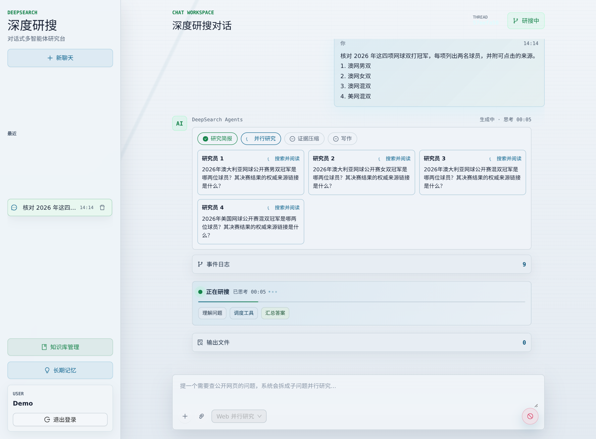
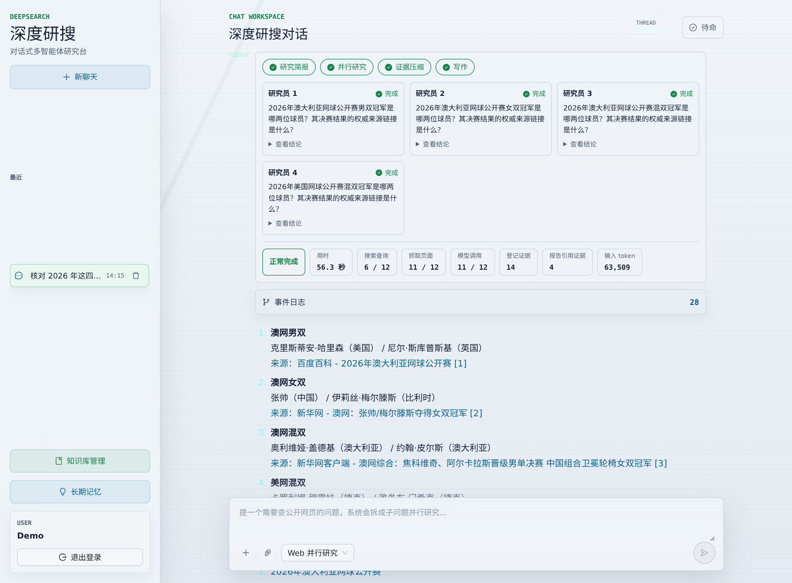
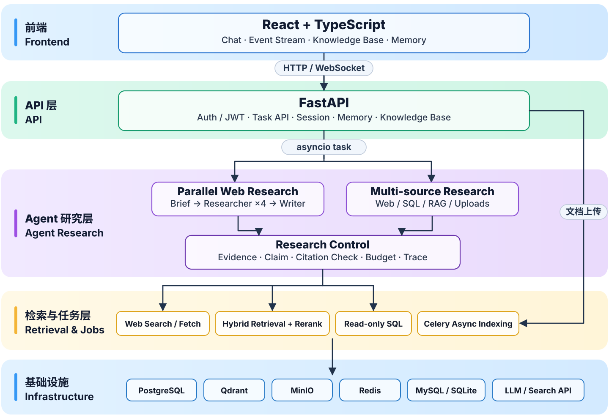
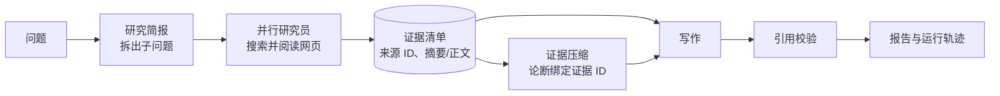

# DeepSearch Agents

<p align="center">
  中文 | <a href="README.en.md">English</a>
</p>

DeepSearch Agents 是一个带来源引用和运行轨迹的多智能体研究助手。提出一个问题后，系统把它拆成子问题，并行派出多个研究员搜索和阅读网页，最后生成带原文链接的研究报告。除公开网页外，它还支持本地知识库、SQL 数据库和上传附件。



## 实际运行

这次网球双打查证将不同子问题并行派发给多个研究员。任务完成后，界面展示各阶段状态、搜索和模型用量，以及报告中的原文链接。



## 系统架构



前端通过 HTTP 提交任务，FastAPI 在后台异步执行研究，并通过 WebSocket 推送进度和报告。纯 Web 问题走下方的并行研究流程，涉及知识库、数据库或附件的问题走多源研究流程。知识库文档由 Celery 异步解析和索引，Redis 作为任务队列。

## 研究流程



- **研究简报**：一次结构化调用，输出约束和子问题。
- **并行研究**：由后端代码按子问题派发研究员，每个研究员只有搜索工具，最多两次模型调用。
- **证据清单**：每个网页登记为一条带固定 ID 的证据，保存在后端，不经过模型转述。
- **证据压缩与写作**：论断必须引用证据 ID，后端校验 ID 存在；写作模型同时读取论断和证据原文。
- **预算与轨迹**：每次运行受搜索次数、页面数、模型调用数和时间四个上限约束，各阶段的调用和证据去向写入轨迹文件。

## 功能

- 多源研究：公开网页（Tavily、DuckDuckGo、Perplexity、SearXNG）、本地知识库（BM25 与向量混合检索）、MySQL 只读查询、上传附件。
- 可追溯报告：句后引用证据 ID，可点回原始网页或文档片段。
- Web 工作台：聊天、实时任务事件、知识库管理、历史会话、结果下载。
- 会话与记忆：用户注册登录、会话摘要、可管理的长期记忆。
- 评测工具：端到端、过程和检索组件三层评测脚本，结果可复算。

## 评测结果

**运行过程。** 早期版本由主管模型自行决定何时派发子任务，常常调用无关工具、耗尽预算后降级。改为后端代码按子问题并行派发、并限制研究员可用工具后，在 15 道 DeepResearch Bench 题目上：

| 指标 | 旧主管循环 | 并行研究 |
| --- | ---: | ---: |
| 正常完成 | 2/15 | 12/15 |
| 每题耗时中位数 | 118.5 秒 | 58.1 秒 |
| 每题输入 token 中位数 | 72,932 | 36,192 |
| 与研究无关的工具调用 | 53 | 0 |

详见 [过程评测](docs/development/drb-process-evaluation.md)。

**近期事实题。** 题目问 2026 年发生的事实，模型自身答不出。每题 4 个事实项，对照官方出处逐项判分。原 12 题用于缺陷诊断，独立 6 题在修复后单独运行。

| 题集 | 闭卷 | 单轮检索（≤3 查询） | 单轮检索（≤8 查询） | 并行研究 |
| --- | ---: | ---: | ---: | ---: |
| 原 12 题 | 0/48 | 30/48 | 39/48 | 42/48 |
| 独立 6 题 | 0/24 | 17/24 | 19/24 | 23/24 |
| 每题耗时中位数（原题） | 1.2 秒 | 13.3 秒 | 13.9 秒 | 38.2 秒 |

并行研究在两组题上都比 8 查询基线多答对 3–4 项；代价是在原题上，中位耗时约为基线的 2.8 倍，输入 token 约 4.6 倍。详见 [事实题评测](docs/development/retrieval-necessity-2026.md)。

**本地知识库检索。** 在固定的 RFC 9110 / 9111 语料上，词法排序换成 BM25 后，7 道开发题的标注证据命中由 6/15 升至 15/15。详见 [BM25 对照](evals/rfc_demo/bm25.md)。

以上实验均使用 Qwen Flash，题量小，每种配置运行一次，在线搜索结果会随时间变化。引用校验检查证据 ID 是否存在，原文是否支持论断由事实题评测另行检验。早期版本的报告内容评分见 [DRB 评测与交叉实验](docs/development/drb-duckduckgo-15.md)。

## 快速开始

环境要求：Docker 与 Docker Compose、Node.js 与 pnpm、一个 OpenAI 兼容的模型 API。

**1. 获取代码并配置**

```bash
git clone https://github.com/huichimegumi/deepsearch-agents.git
cd deepsearch-agents
cp .env.example .env
```

编辑 `.env`，至少填写模型配置：

```dotenv
LLM_PROVIDER=dashscope
OPENAI_BASE_URL=https://dashscope.aliyuncs.com/compatible-mode/v1
LLM_NAME=qwen-flash
DASHSCOPE_API_KEY=

# 启用并行 Web 研究
RESEARCH_WORKFLOW=parallel_web

# 搜索：未配置的后端会被跳过，DuckDuckGo 无需密钥
SEARCH_BACKEND=auto
TAVILY_API_KEY=
```

`LLM_PROVIDER` 可选 `dashscope`、`deepseek`、`openai`，分别读取 `DASHSCOPE_API_KEY`、`DEEPSEEK_API_KEY`、`OPENAI_API_KEY`。其余参数见 [`.env.example`](.env.example)。

**2. 启动后端**

```bash
docker compose --env-file .env -f docker/docker-compose.yaml up -d --build
curl http://localhost:8000/health/ready
```

这会启动 API、索引 Worker、PostgreSQL、Redis、Qdrant、MinIO 和 MySQL。

**3. 启动前端**

```bash
cd frontend
pnpm install
pnpm dev
```

浏览器打开 `http://localhost:5173`，注册账号后即可使用。默认的注册开关、JWT 密钥和服务凭据仅用于本地开发，公开部署前需要替换。

**通过 API 发起并行 Web 研究**（并行模式目前需在请求中指定 `"sources": ["web"]`）：

```bash
curl -s http://localhost:8000/api/task \
  -H "Authorization: Bearer $TOKEN" -H 'Content-Type: application/json' \
  -d '{"query": "列出 2026 年澳网男双、女双、混双冠军", "sources": ["web"]}'
```

其中 `$TOKEN` 为 `POST /api/auth/login` 返回的 `access_token`。返回的 `thread_id` 用于通过 `WebSocket /ws/{thread_id}?token=<token>` 接收实时事件和最终报告。登录、本地开发、测试命令和完整 API 列表见 [项目手册](docs/manual.md)；评测复算见 [`evals/README.md`](evals/README.md)。

## 项目结构

```text
app/
├── agent/      # 研究流程：简报、并行研究员、证据压缩、写作、预算与轨迹
├── research/   # 证据与论断的数据结构、引用校验
├── search/     # 多搜索后端、降级与网页正文抓取
├── rag/        # 文档解析、索引、混合检索
├── api/        # FastAPI、WebSocket、会话与知识库接口
├── memory/     # 会话摘要与长期记忆
└── tools/      # 搜索、数据库、知识库、附件工具
evals/          # 评测脚本与可公开的汇总结果
docs/           # 评测报告、设计文档、项目手册
frontend/       # React 工作台
docker/         # Dockerfile 与 Compose
```

技术栈：LangChain / LangGraph / DeepAgents、FastAPI、Celery、PostgreSQL、Qdrant、Redis、MinIO、React、TypeScript。

## 更多文档

- [项目手册与开发记录](docs/manual.md)：完整部署说明、API 列表、历史开发记录
- [并行研究设计说明](docs/development/parallel-research-design.md)
- [历史固定语料评测](EVAL.md)
