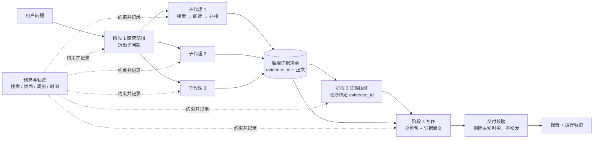

# 并行研究路径：设计与实施说明

本文是下一轮改动的设计，供实现时对照。范围只有一轮，做完复测即止。

## 1. 现在的请求路径

一次网页研究请求经过的模块，按顺序：

| 步骤 | 位置 | 做什么 | 模型调用 |
| --- | --- | --- | --- |
| 入口 | `app/api/server.py:191` → `app/research/service.py:39` | `RESEARCH_WORKFLOW=legacy` 时进入 `run_deep_agent` | 0 |
| 预算与轨迹 | `app/agent/main_agent.py:1682` | 按档位建立 `ResearchBudget`（`deep_report`：12 次搜索、12 页、12 次模型调用、300 秒）和 `ResearchRunTrace` | 0 |
| 阶段 1 研究简报 | `_run_direct_phase`，输出 `ResearchBrief` | 一次结构化调用，产出约束、信息源计划和子问题 | 1 |
| 阶段 2 主管研究 | `_run_agent_phase`，智能体由 `create_deep_agent` 创建 | 主管循环调用工具；网页检索要通过 `task` 派发给 `network_search` 子代理，子代理再调用 `research_search` | 不定，受预算限制 |
| 阶段 3 证据压缩 | `_run_direct_phase`，输出 `CompressedEvidence` | 只读后端证据清单，产出带 `evidence_id` 的论断；后端校验每个 ID | 1 |
| 阶段 4 最终报告 | `_run_direct_phase` | 只读简报和已校验的论断包，写报告 | 1 |
| 交付校验 | `_enforce_final_report_citations` | 报告引用了未知 ID 或没有引用时，退回论断包或扣发 | 0 |

两个与本次改动直接相关的事实：

- 阶段 2 的主管文字产出不会传给后面。`_compression_phase_outputs`（`main_agent.py:666`）用后端证据清单替换了它。主管最后几次“整理证据台账”的调用对结果没有贡献。
- 阶段 4 看不到网页正文。`build_phase_prompt`（`research_workflow.py:244`）只保留简报和论断包，阶段指令要求“只基于论断包”“证据不足时写明无法判断”。

## 2. 轨迹里看到的问题

来自归档的 C、D 两组各 16 次运行（Qwen Flash，DuckDuckGo）：

| 问题 | 数据 | 原因 |
| --- | --- | --- |
| 没有并行派发 | 每次运行约 1.2 个子代理 | 由主管模型自行决定是否拆分，便宜模型倾向于整题交给一个子代理 |
| 预算花在无关工具上 | C 组主管 97 次工具调用中，待办、列目录、文件匹配共 53 次 | `create_deep_agent` 默认带待办和文件系统工具 |
| 主管阶段没有产出 | C 组 14/16、D 组 8/16 | 调用次数先用完 |
| 多收集的证据没进报告 | D 组收集 172 条，报告引用 67 条 | 压缩阶段只保留被论断引用的证据，写作阶段看不到其余的 |
| 写作保守 | 报告开头出现“证据不足”类表述：C 2/16，D 4/16，A 0/16 | 阶段 4 指令如此要求 |

## 3. 改动

新增一种研究模式 `parallel_web`，与现有路径并存。现有路径不改，SQL、本地文档、上传文件的任务继续走它。

### 3.1 并行派发子代理，替换主管循环

阶段 2 在 `parallel_web` 模式下改为：

1. 取阶段 1 `ResearchBrief.subquestions` 的前 N 个。`deep_report` 档 N 最大为 3，`thorough` 档最大为 5。子问题为空时，用原始问题作为唯一子问题。
2. 由后端代码用 `asyncio.gather` 同时启动 N 个子代理，每个负责一个子问题。
3. 全部返回后，把各子代理的简短结论拼接起来，作为阶段 2 的产出。

子代理的规格：

- 用 `langchain.agents.create_agent` 创建，不用 `create_deep_agent`，没有待办、文件系统和再派发能力。`get_indexed_local_research_agent`（`main_agent.py:95`）是现成的参照。
- 只有一个工具 `search_web(queries: list[str])`。它是对 `research_search` 的薄封装，固定 `fetch_full_page=True`，并把查询数和页面数截到本子代理的份额（运行级上限除以 N，向下取整）。模型看到的参数只有 `queries`。
- 每个子代理最多 3 次模型调用、2 次搜索，用 `recursion_limit` 限制。
- 系统提示词要求：围绕子问题设计 2–4 个互补查询；读完返回的正文后判断是否需要再搜一次；最后用不超过 200 字给出结论，列出支撑它的 `evidence_id` 和仍然缺失的内容。
- 子代理之间互不可见，各自的搜索结果只在自己的上下文里。

固定 `fetch_full_page=True` 的原因：`research_search` 的默认值是 `False`，只返回候选而不登记证据。归档运行里有搜索次数用满却只抓到两三页的情况。

预算与记录：

- 模型调用计数复用现有的发送前计数（`ResearchBudget.admit_research_calls_before_transport`，`app/agent/llm.py:33`），本模式下固定开启。子代理触发 `PhaseBudgetExceeded` 或递归上限时只结束该子代理，已登记的证据保留。
- `gather` 使用 `return_exceptions=True`。单个子代理失败不影响其他子代理。
- `research_search` 是同步工具，会在线程里并发执行。`ResearchBudget` 的 `take_search_queries`、`take_fetched_pages`、`take_llm_call` 需要加一把 `threading.Lock`。
- 每个子代理在轨迹里记一次 `task` 工具调用，使 `subagent_calls` 与归档数据可比；子代理的每条模型消息调用 `run_trace.record_llm_call("supervisor_research", message)` 计入 token。先确认 `research_search` 内部是否已记录工具调用，避免重复计数。
- 每个子代理启动时调用 `monitor.report_assistant`，描述填子问题，前端能看到并行的子代理。

`deep_report` 档的调用预算核算：简报 1 + 子代理 3×3 + 压缩 1 + 写作 1 = 12，正好等于上限。

### 3.2 写作阶段拿到证据原文

`parallel_web` 模式下，阶段 4 的输入和指令改为：

- 输入增加后端证据清单：`run_trace.render_evidence_ledger(claim_eligible_only=True)`，沿用它已有的 24,000 字符总上限和单条 4,000 字符上限。论断包继续提供，作为要点和提纲。
- 指令改为：完整回答任务提出的每一项要求；有来源支持的陈述在句后引用 `[evidence_id]`，可以引用清单里的任何 ID；任务要求但来源没有覆盖的内容仍然作答，并在该句或该段标明“未检索到来源”；不得编造 ID；不得以证据不足为由拒绝作答。
- 输出上限与基线一致，不低于 8,000 token。

### 3.3 交付校验不再扣发整篇

`parallel_web` 模式下：

- 允许引用的 ID 集合从“被论断引用的证据”扩大到“全部可用于论断的证据”（`run_trace.claim_eligible_evidence_ids`）。
- 报告里出现未知 ID 时，只删除这些引用标记，保留正文，并在轨迹里记录删除数量、把运行标为降级。
- 报告没有任何引用且有可用证据时，照常交付，在轨迹里记录并标为降级。
- 不使用上一轮的 `retain_cited_paragraphs`。它会丢掉所有标题和列表块，交付的报告结构不完整。

### 3.4 代码放在哪里

- 新文件 `app/agent/parallel_research.py`：子代理的创建、`search_web` 封装、并行执行函数，预计 120 行以内。
- `app/agent/main_agent.py`：`run_deep_agent` 增加参数 `research_mode: str = "supervisor"`；阶段循环在阶段 2 增加一个分支；阶段 1 保留解析后的 `ResearchBrief` 对象以读取子问题；阶段 4 的交付校验按 3.3 分支。
- `app/agent/research_workflow.py`：`build_phase_prompt` 在本模式下为阶段 4 追加证据清单并换用 3.2 的指令。
- `app/agent/runtime.py`：预算加锁。
- `evals/drb_osodt/run_agent.py`：增加 `--research-mode`。

本地限定检索、有上传文件或 `indexed_local_only` 的运行忽略 `parallel_web`，回到现有路径。本轮不做自动路由。

## 4. 复测

新增一组 P：`parallel_web` 模式，`deep_report` 档，Qwen Flash，DuckDuckGo，与归档相同的 15 道题，只跑一次。

过程指标与归档 C 组比较（同档位），预期方向事先写明：

| 指标 | 归档 C | 预期 |
| --- | --- | --- |
| 每次运行的子代理数 | 约 1.2 | 等于子问题数，上限 3 |
| 主管阶段的待办、目录类工具调用 | 53 次 | 0 |
| 正常完成（未降级） | 2/16 | 多数 |
| 阶段 2 无产出 | 14/16 | 接近 0 |
| 证据进入报告的比例 | 58% | 上升 |
| 耗时中位数 | 117 秒 | 下降 |
| 每题输入 token | 约 7.7 万 | 方向不确定，如实报告 |

质量用原 OSODT 设置评分，与归档 A、C 按题配对。判定规则沿用：均分差小于 0.30 记为接近。目标是与 A 接近，不要求超过。

复测结果无论好坏都如实写入文档，不再做第二轮修改。

## 5. 同时进行的两件事

这两项不依赖上面的改动，可以先做。

**过程评测报告。** 新脚本读取各组归档的 `research_trace.json`，输出每组的：模型调用数、输入输出 token、各阶段耗时和产出状态、工具调用分布、子代理数、搜索与抓取数、证据漏斗（收集、进入论断、报告引用）、重复查询数、降级原因。A 组没有轨迹，用 `worker_result.json` 里的调用数、token 和耗时。不调用模型。

**闭卷对照。** A 的写作提示词，来源列表为空，同样 15 道题，原 OSODT 设置评分，与 A 按题配对。它回答一个问题：这套内容评分是否依赖检索。现有线索是交叉实验中 4 份零证据报告均分 6.97，同题 A 组 6.29。若闭卷与 A 的均分差小于 0.30，文档里应写明内容分主要反映写作模型自身的知识和文风，不能用来比较检索深度。
